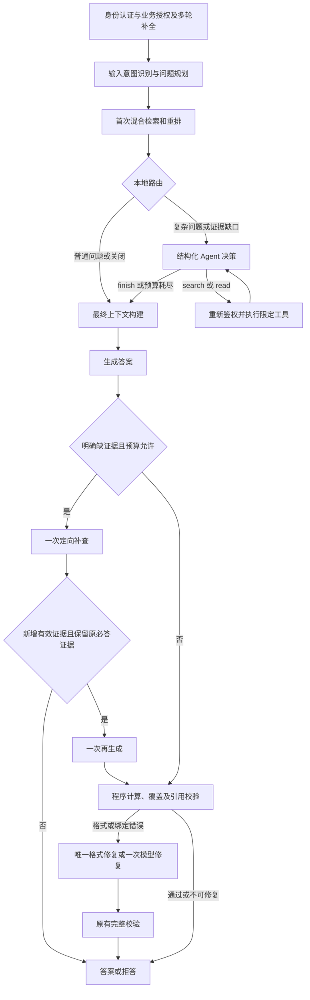

# 输入路由、自检修复与有预算约束的 Agent 证据收集

## 当前实现位置

API 完成认证、授权和治理后进入问答。多轮问题先由现有 resolver 补全，
`AnswerService.answer()` 再调用 `QueryPlanner`，之后执行 `EvidenceCoordinator.collect()` 的首次混合检索。
输入规划建议 standard、reflective 或 agentic；实际证据缺口可以升级到 Agent，
生成后的可修复校验错误可以升级到 reflective。路径共享检索服务与最终校验。
首次生成声明明确证据缺口时，可按原问题片段定向补查一次并再生成一次，额外调用共享预算。
Agent 不生成最终答案；修复不允许添加、删除、重排或改写结论，不能将缺证据/拒答改判为通过。



这是一个单 Agent 的结构化动作循环，不使用多 Agent、任意代码执行或新的向量后端。
本地路由只决定是否值得增加模型调用，不判断证据真假。Agent 根据当前证据决定下一个动作，
循环、参数校验、身份和预算由程序控制，因此区别于只按固定 if/else 重试检索。

## 动作与工具边界

| 动作 | 模型可提供的参数 | 后端行为 |
| --- | --- | --- |
| search | 一个不超过 400 字符的 query | 复用原有向量 + BM25 + RRF + 重排，在固定授权范围内补查 |
| read | 当前证据池中的 E 编号 | 回查该锚点的当前版本，最多读取前后各两块，共五块原文 |
| finish | 无 | 停止证据收集；后续仍必须生成并校验答案 |

模型不能传 tenant_id、知识库 ID、任意文档路径、SQL、URL 或管理员凭据。未知字段、
不匹配的工具参数、未见锚点及重复查询会终止补查。finish 不表示答案已经完整或正确。
计算继续由原有 `compute()` 在生成后校验来源、单位、顺序和前提并执行；首版没有给 Agent 增加计算工具。

## 权限与版本保证

- API 验签并授权后，将 actor_user_id 和原 external_subject 放入请求局部审计上下文；模型不能设置这些值。
- 每轮决策、工具执行前后和最终证据输出前，读取当前有效用户、租户、知识库及业务授权。
- 新授权不会扩大本次固定 RetrievalScope；原范围中有撤权、账号停用、知识库停用或身份重绑定时，停止本次请求。
- 没有可信 actor 的直接内部调用保留首轮链路，跳过 Agent；不根据提问内容猜测身份。
- Agent 的输入和最终输出都回查 SQL 当前 ready 分块及 vector_generation。模型输入中不使用检索器提供的伪造正文，更新或删除后的旧证据会丢弃。
- read 只能读取当前池中已有锚点的相邻内容，继续限定租户、知识库、文档、版本和 ready 状态。

授权与文档版本检查按各阶段 SQL 回查时点判定，最终生成使用本次已验证的证据快照。
不能撤回已经发送给模型的上下文；不宣称零时间窗口的即时撤销或生成期间实时同步更新。

## 默认预算与关闭方式

| 环境变量 | 默认值 | 含义 |
| --- | --- | --- |
| AGENTIC_RAG_MODE | auto | off：原单次检索；auto：本地路由；always：受控调试时强制尝试 |
| AGENT_MAX_DECISIONS | 2 | 最多两个决策模型调用 |
| AGENT_MAX_SEARCHES | 2 | 包含首轮检索，总共最多两次混合检索 |
| AGENT_MAX_READS | 1 | 最多一次相邻原文读取 |
| AGENT_MAX_EVIDENCE | 24 | 合并后的最大分块数 |
| AGENT_MAX_PROMPT_BYTES | 12000 | 决策提示词、可见证据和结构化 schema 的 UTF-8 字节预算 |
| AGENT_MAX_OUTPUT_TOKENS | 384 | 每次决策模型输出上限 |
| AGENT_MAX_DECISION_TOKENS | 16000 | 决策阶段累计用量预算，调用前按字节及输出上限保守预留 |
| AGENT_MAX_SECONDS | 20 | 首轮检索之后的可选证据收集时间预算 |
| AGENT_DECISION_TIMEOUT_SECONDS | 8 | 单次决策请求最大配置超时，且不超过剩余阶段预算 |

已知调用用量按供应商报告累计；未知用量按本次保守预留计入控制预算，不视为免费。
预算控制数不是供应商账单或精确 tokenizer 计数。字节预留包含 schema 和消息封装余量。
额外检索的 embedding 和 rerank 费用另外记在原有阶段，其次数由工具轮数限制。
这些限制不覆盖原来首轮检索、最终答案生成及多轮问题改写的全部 Token。

阶段超时会阻止继续派发工具，SDK、嵌入、Milvus 和重排按剩余预算收紧请求超时；
在途 SQL 与底层网络超时仍可能使实际耗时略超过阶段预算，不是强制取消所有阻塞工作的硬实时保证。
每次请求通过 ContextVar 隔离超时，不修改共享客户端配置；不会影响其他租户请求。

仅关闭 Agent 证据工具时在 `.env` 设置 `AGENTIC_RAG_MODE=off`，重新创建 API：

```powershell
docker compose up -d api
```

修改代码需构建部署，单改配置需重新创建容器而非只 restart。无需迁移 SQL 结构或重建向量。

## 合并、上下文和降级

证据按租户、知识库、分块及 generation 去重。补查/补读与原证据交错排序，保留首轮首条证据，
同时给补充内容留出每来源四块预算中的位置。这只是有限排序，不冒称一次新的重排。
合并后按原问题重新做适用性选择，最后仍受原有 12000 字符和每来源四块的上下文限制。
E 编号仅供 Agent 选择工具，最终资料编号由 ContextBuilder 重新生成，防止跨轮引用编号漂移。

Agent 输出格式错误、可选工具失败或预算耗尽时，使用已获得并重新确认有效的证据继续原链路。
权限错误与关系数据库错误不能通过回退旧证据绕过；无证据时由原流程拒答。
证据收集本身不修复 coverage。新接入的有限修复处理结构/绑定错误，
不处理无依据数字、计算输入失败或真实证据缺口，不能保证引入 Agent 就提高答案准确率。

## 观测与测试

- 新增模型用量阶段 agent_decision，复用独立用量账本与供应商用量/定价快照；不保存凭据或隐藏推理。
- 非旁路请求的 timings 增加 agent_decision_ms、agent_tool_ms；普通响应不增加空字段。
- Prometheus 新增 enterprise_agent_runs_total、enterprise_agent_actions_total、enterprise_agent_seconds。
- opt-in trace 保存动作、原因分类、预算停止点和补查轨迹。首轮检索的 fusion/rerank 轨迹保留，补查单列 agent_retrieval，合并结果单列 agent_evidence。
- 补查中的模型事件同时计入父 trace，原问题与授权范围不会被补查问题覆盖。
- 当前快进合并与新分支只在本地进行，不包含推送或远端 PR。

测试覆盖旁路零额外调用、搜索/邻块循环、提示词与 Token 预留、时间和轮数上限、重复查询、
非法动作/参数、越权内容、撤权、身份重绑定、旧版本失效、SQL 权威正文、接口兼容性与请求间预算隔离。
真实集成使用专用 _test PostgreSQL 数据库和唯一 Milvus 测试集合；决定模型、嵌入和重排可替换为确定性实现，不产生模型费用。

## 首版 Agent 验收记录（输入规划之前）

先将 Milvus 认证改动提交为 `b765a67`（启用Milvus服务认证并隔离后台账号权限），
然后将 `codex/migrate-to-milvus` 快进合并到本地 main，并从该提交创建 `codex/agentic-rag`。

| 检查 | 结果 |
| --- | --- |
| 完整单元/API 回归 | 781/781，无失败、错误或跳过 |
| PostgreSQL / Milvus / Redis 真实集成回归 | 34/34，包含新 Agent 搜索、邻块与撤权用例 |
| 最终 Agent 工具真实集成复核 | 2/2 |
| 前端认证、会话和引用预览 | 19/19 |
| 已配置模型的合成结构化决策冒烟 | 3/3，完整证据 finish、缺少另一对象 search、章节索引 read |
| 部署模式与服务账号 | auto；最多两次决策、总共两轮检索；API 仍使用 kb_api |
| 已部署 readiness / indexing health | 均为 HTTP 200 |
| 已部署匿名问答 | HTTP 401，无模型调用 |
| 原 SQL 文档/当前分块及向量快照 | 54 份、470 个，数量匹配且向量和元数据逐条不变 |

合成冒烟成功的三次决策调用报告合计 1024 Token，金额因未配置核实单价而未知。
首次试验另有一次格式解析失败，供应商用量未取得，不计为零或免费。
发现部分兼容接口对未使用参数返回空字符串，现仅将未使用的空参数规范化为 null；
search/read 的必需参数和未注册字段仍严格拒绝。

原始证据在被 Git 忽略的 `data/ingestion-reports/agentic-rag/`：
`unit-tests.xml`、`integration-tests.xml`、`final-agent-integration.xml`、`model-smoke.json`、
`initial-model-smoke-failure.json`、`deployment-verification.json`。
临时 PostgreSQL 数据库与测试 Milvus 集合在验收后清理；不删除业务数据库或向量卷。

合成冒烟可显式复现（会产生模型费用，已有报告不会覆盖）：

```powershell
python scripts/verify_agent_decisions.py --allow-model-calls --output data/ingestion-reports/agentic-rag/new-model-smoke.json
```

这次没有执行新的完整 80 题评估或带有效 JWT 的真实问答性能验收。
SQL/Milvus 集成的嵌入、重排与决策使用确定性测试实现，真实模型冒烟只验证动作接口，
两者不能拼成真实端到端答案准确率。旧 68/80 报告属于 Agent 引入前版本，不能直接视作本次实现的质量成绩。

## 输入规划与三种执行路径

`query_planner.py` 在首次检索之前识别 fact、comparison、explanation、calculation、procedure、multi_part。
默认 auto 模式使用本地规则处理直接事实、条件/程序/原因及计算题；比较、多时期、多方面或多个问句
才尝试一次结构化模型规划。规则不是完整语义分类器，未命中复杂表达时可能选错路径，需要独立评估。
没有可信请求 actor 时不调用规划模型；模型故障、无效参数或预算耗尽时使用本地规则回退。

| 策略 | 实际执行 |
| --- | --- |
| standard | 原问题首次混合检索、生成与现有校验；成功时零额外规划/修复调用 |
| reflective | 一次检索、生成、程序自检；仅可修复错误才调用修复模型，最多一次 |
| agentic | 首次检索后进入现有 search/read/finish 循环，再统一生成和校验；必要时仍可结构修复 |

这是带自检修复的工程流程，不是使用反思标记训练模型的论文 Self-RAG。
路由是建议：非 Agent 路径遇到空证据或只有前言可以升级；普通路径生成结构错误也可进入修复。
证据非空不等于足够；当前支持生成明确缺证据后的单次反馈闭环，但没有逐项语义证据覆盖评分。
`AGENTIC_RAG_MODE=off` 禁用 Agent 工具循环；always 仍用于受控调试。
每次 search 内部的向量+BM25、RRF与重排固定，read 仍读取相邻原文。本次不引入父子块。

规划最多三个子问题，每项包含 question、原问题连续 source_quote、depends_on 前序序号。
后端拒绝不存在的原文锚点、新数字/拉丁编号、重复项、循环/前向依赖及额外身份/权限字段；
存在依赖必须选 agentic。以上只能限制明显偏移，不能证明拆分的完整语义等价。
原始（多轮已补全）问题永远用于首次检索、生成和最终校验，不被子问题替换。
Q原文锚点与E表格条件继续保留；P1..P3加入覆盖清单，最终草稿也必须覆盖这些辅助项。
依赖和子问题提供给 Agent 决策，程序不会为每个子问题自动执行一轮查询或重置预算。

## 有限修复边界

`answer_repair.py` 先把可唯一确定的 `[资料1]` 等格式规范为现有引用编号，再完整验证。
本地不能解决时，只针对 coverage 缺记录/非法索引、引用编号缺失或绑定错误发起一次模型调用。
只有可回答草稿且已有 coverage 全为 answered 才有资格；明确 insufficient/withheld、拒答、
无依据数字/日期、空结论等不进入常规结构修复；受限计算失败使用后述的原文与程序验证专用修复路径。

常规结构修复中模型只能修改 citations 与 coverage；answerable、refusal_reason、claims 数量/顺序/text/calculation
必须完全一致。候选修改事实、删掉错误结论或未通过原有覆盖/引用/数值校验时，丢弃候选并保留拒答。
调用前后重新鉴权、回查 SQL 并重建上下文；原文、版本或适用政策变化时不接受修复。
格式规范后发现真实数字不受支持也停止，不能借错误引用掩盖事实错误。
修复提示词超限时不截断原文后盲修，直接回退。首轮失败的回答与覆盖仍保留在 opt-in trace。

覆盖判断仍有模型自述成分，数值检查也不证明完整语义蕴含；修复成功不能等同于事实正确的保证。

## 共享预算与配置

| 变量 | 默认值 | 作用 |
| --- | --- | --- |
| RAG_PLANNER_MODE | auto | off 或 auto |
| RAG_REPAIR_ENABLED | true | 是否允许有限自检修复 |
| RAG_FEEDBACK_ENABLED | true | 是否允许一次缺证据反馈补查及再生成 |
| RAG_MAX_OPTIONAL_CALLS | 4 | 规划+Agent决策+修复+再生成的共享模型调用上限 |
| RAG_MAX_OPTIONAL_TOKENS | 32000 | 同上阶段的共享用量预算 |
| RAG_MAX_OPTIONAL_SECONDS | 35 | 同上模型与额外工具的累计执行时间预算 |
| RAG_PLANNER_OUTPUT_TOKENS | 768 | 单次规划输出上限 |
| RAG_PLANNER_TIMEOUT_SECONDS | 8 | 规划请求超时，受剩余时间收紧 |
| RAG_REPAIR_OUTPUT_TOKENS | 1536 | 单次修复输出上限 |
| RAG_REPAIR_TIMEOUT_SECONDS | 8 | 修复请求超时，受剩余时间收紧 |
| RAG_REPAIR_PROMPT_BYTES | 24000 | 完整修复提示词含schema的字节上限 |
| RAG_MAX_SEARCHES | 3 | 首次、Agent补查及反馈补查的共享检索总上限 |
| RAG_REGENERATION_OUTPUT_TOKENS | 2048 | 唯一一次再生成输出上限 |
| RAG_REGENERATION_TIMEOUT_SECONDS | 15 | 再生成超时，受共享剩余时间收紧 |

共享检索总上限RAG_MAX_SEARCHES=3；原Agent循环仍受AGENT_MAX_SEARCHES=2（包含首次）限制，
生成反馈最多额外补查一次；共享读取次数沿用AGENT_MAX_READS=1。
Agent 原有两次决策、阶段deadline和局部用量限制继续有效，取更严格约束。
时间按可选模型及工具调用累计；再生成属于可选模型预算，首次检索、首次生成、多轮改写及本地SQL检查不在其中。
额外 search 的 embedding/rerank 调用按原阶段入账并受工具次数约束，不计入这四次决策类模型配额。
已知零用量也是已知，未知用量/失败消耗字节与输出预留，不当作免费；不是整次请求或账单的硬上限。
预算、规划通过 ContextVar 按请求隔离，共享服务对象不保存某个用户的计划。

恢复原单次检索且不规划/修复/反馈，在 `.env` 同时设置以下四项后重新创建 API：

```dotenv
RAG_PLANNER_MODE=off
RAG_REPAIR_ENABLED=false
RAG_FEEDBACK_ENABLED=false
AGENTIC_RAG_MODE=off
```

```powershell
docker compose up -d --no-deps api
```

## 本次输入路由验收（2026-10-14）

在现有 `codex/agentic-rag` 分支实施，不新增依赖、SQL迁移或向量重入库。

- 完整单元/API回归845/845；真实PostgreSQL/Milvus/Redis集成37/37；前端19/19。
- 最终预算计数/文本校验修正后，108项相关单元回归与5项真实规划/Agent/修复集成复核通过。
- 新集成覆盖输入规划与Agent共用真实授权、规划/修复模型调用期间撤权必须终止。
- 合成路由/修复接口4/4：简单查询与条件查询无额外规划调用；比较题经模型拆成两个子问题并选reflective；覆盖索引一次修复通过原校验。
- 该合成检查共2次实际模型调用、747供应商报告tokens，未知用量0、错误0；未配置核实单价所以金额未知。
- 独立合成检查模拟了actor/证据新鲜性，不连接业务SQL账本，因此2个事件未持久化；真实请求继续写独立账本。
- 未执行新的完整80题质量评估或带有效JWT的真实问答性能验收；不可宣称已提升准确率。
- API/Worker已构建部署；七个核心源文件哈希与容器一致，auto规划/Agent及修复启用，API继续使用kb_api。
- readiness/indexing为200、匿名问答401；业务54份ready文档、470块正文和470条向量，数量保持一致。
- 专用临时PostgreSQL容器及唯一Milvus测试集合验收后清理；业务卷保留。

新增用量阶段query_planning、answer_repair；timings按需增加query_planning_ms、answer_repair_ms。
Prometheus增加enterprise_rag_routes_total（阶段/策略）、enterprise_rag_repairs_total（结果）。
opt-in trace的rag_routing保存计划、路径调整、修复结果和共享预算，不增加公开API调试字段。
报告保存在Git忽略的 `data/ingestion-reports/rag-routing/`，包含unit-tests.xml、integration-tests.xml、
final-routing-tests.xml、final-integration-tests.xml、model-smoke.json与deployment-verification.json。

合成接口检查可显式复现（产生费用，报告不能覆盖）：

```powershell
python scripts/verify_rag_routes.py --allow-model-calls --output data/ingestion-reports/rag-routing/new-model-smoke.json
```

## 一次证据反馈闭环

`GenerationAnswerDraft.evidence_gap` 是生成阶段的可见反馈，不写入公开回答或会话API。
reason区分missing_evidence、conflict、unsupported_request；requirement_ids仅引用当前必答清单，
source_quote仅为原问题连续片段，不接受自由查询、身份、权限或工具参数。
旧草稿没有此字段时默认为null，继续原链路；未使用的空source_quote可规范为null，但不能因此触发补查。

`evidence_feedback.py` 仅接受以下组合：answerable=false、claims为空、明确拒答理由、
反馈副本的覆盖记录通过校验、选定编号确实有insufficient要点、原文锚点有效且reason=missing_evidence。
冲突、超出能力、伪造锚点/编号、引用格式错误或猜测数字不进入补查。
可回答草稿同时声明证据缺口也必须被最终覆盖校验拒绝。

兼容整体拒答的局部输出格式：存在真实insufficient要点时，可在反馈副本中把未输出的answered
要点规范为withheld。若首稿还包含已知部分的claims，必须先通过现有引用、数值与计算校验，
才可从反馈副本清除；未知索引、无依据数字等仍停止。原始首稿、结论与校验错误保留，不对外返回。
这不把缺证据改为有证据，不修正或复用部分事实；第二次模型从完整原问题及当前授权正文重新生成，
最终仍执行原有全部校验。其他格式错误不会通过这种确定性规范化放行。

后端把source_quote作为重点，附上完整原问题构造一次查询。首次与Agent补查历史按NFKC、
空白归一及大小写归一共享；已执行查询、已查重点或把整题原样当重点均停止，不用改写掩盖重复查询。
补查复用原有混合检索/重排，不调用新的决策模型；模型的结构化缺口是本轮工具选择信号。

调用前先检查当前上下文的再生成预留与共享检索/时间预算，并重新鉴权、回查SQL当前证据。
补查后再次检查身份、版本及正文；按原问题筛选适用性，合并结果仍受24块池、12000字符、每来源4块限制。
首次上下文中的有效证据与表格必答条件必须保留，不能为了新证据挤掉既有依据。
新上下文必须含非前言且不同于已用正文的内容；相同正文、越权结果或无法进入上下文的命中不触发再生成。
这是可用正文新增的判断，不证明新增正文语义上足够。未来正式制度缺口仍受原有检查约束。

扩大后的完整提示词再次检查共享Token预算，绝不截掉原问题或绕过必答项以凑预算。
只调用一次answer_regeneration，使用完整原问题、重建资料编号和原有生成规则；输出上限2048，超时最多15秒。
模型调用前后检查授权，生成后再次回查SQL，正文/版本/适用性变化则丢弃候选。
再生成后统一执行既有程序计算、覆盖、引用与数值校验，并保留现有有限结构修复；
再次缺证据、格式/引用/数字仍不合格或预算耗尽时拒答，不会进行第二轮反馈。

单次反馈与单次再生成同时由代码分支和请求局部预算计数限制，模型无法增加轮数。
规划1次+原Agent决策2次+再生成1次恰好用满默认4次可选模型配额；再生成后若还需模型修复，必须有剩余配额。
补查embedding/rerank单独入账且受共享工具次数/时间限制，4次模型配额及32000Token不是整次问答账单上限。
失败/未知用量继续消耗保守预留。权限错误和SQL错误终止请求，不能回退旧证据绕过。

新增用量阶段answer_regeneration；timings按需增加feedback_search_ms、answer_regeneration_ms。
Prometheus增加enterprise_rag_feedback_total；trace分别保留answer_generation、answer_regeneration、
initial_context、最终context、feedback_retrieval和feedback_evidence，首次拒答不会被后续成功覆盖。

## 一次闭环验收记录（2026-10-14）

- 最终完整单元/API回归889/889；真实PostgreSQL/Milvus/Redis集成45/45；前端19/19。
- 覆盖一次补查/再生成、无新增正文、重复查询、全局预算耗尽、扩大提示词二次预算检查、第二次拒答不重试、
  引用/数值不合格仍拒答、各阶段撤权、生成期间删除文档、局部拒答规范化以及不合格部分结论不能借清除逃逸。
- 实际模型合成闭环最终通过：首次声明缺少乙工艺温度，补查一次后完整再生成，通过原有覆盖、引用和数值校验。
- 成功试验两次模型调用共4897供应商报告tokens；其中再生成2457tokens计入共享预算，额外工具/模型累计6.406秒。
- 兼容过程中另有5次首轮试验：一次超时、一次解析失败、三次声明/覆盖不合格被正确拦截。
  所有6次试验共记录7次模型尝试，已报告12197tokens，另2次用量未知，不计为免费。
- 合成试验的检索、actor与SQL新鲜性为模拟；7个事件未使用SQL sink，金额因无核实单价且有未知用量而未知。
  真实请求仍通过独立账本记录answer_regeneration；不能把合成模型验证和确定性真实数据库测试拼成完整HTTP准确率。
- 最新API/Worker已部署，10个核心源文件哈希与容器一致；反馈启用，共享搜索3次、可选模型4次、32000Token、35秒。
- readiness/indexing返回200，匿名问答401；业务54份ready文档、470块正文、470条向量，API仍使用kb_api。
- 不增加SQL迁移、模型服务或父子块，不重入库。临时测试数据库与唯一Milvus测试集合在验收后清理。
- 未运行新的完整80题评估或带有效JWT的真实问答性能验收，旧68/80仍不能当作本次准确率。

报告位于Git忽略的 `data/ingestion-reports/rag-feedback/`：unit-tests.xml、integration-tests.xml、
model-smoke.json及model-smoke-r2..r6.json、model-attempt-summary.json、deployment-verification.json。
`model-smoke-r6.json`为最终成功报告，其余原始报告保留失败与拦截证据。

```powershell
python scripts/verify_rag_feedback.py --allow-model-calls --output data/ingestion-reports/rag-feedback/new-model-smoke.json
```

上述工具显式调用模型并产生费用，已有报告不覆盖；只发送合成资料，验证服务链路，不代替全量问答评估。

## 问答质量修复与验收（2026-10-14）

此次修复使用真实评估轨迹定位问题，没有修改题集、放宽最终校验、重入库或引入父子块。

- `calculation_repair.py` 将能按秒数严格证明等价的时长恢复为摘录原单位，再调用原计算器验证来源、顺序和前提。
  原文直接事实被误加计算字段时，仅完整原文句子/段落可移除该字段，随后仍运行普通引用与数字校验。
  无法本地修复时，最多一次模型修复。新增计算类型、伪造输入、编造来源、改写直接事实均不被接受；
  模型候选只允许逐字事实或程序计算结果，不能删除必要计算而只输出背景事实。
- 问题分段保留“均为… / 单位为… / 前提是…”等声明性前提，并将其归入所属问题；真正的后续提问仍单独检查。
  前提全文没有被删除，仍参与计算来源与适用条件校验。
- 格式异常记录字段位置与错误类型，不记录异常输入值、密钥或隐含推理。
  有可信身份、证据未变化且预算充足时，允许一次格式恢复生成；失败则明确返回输出格式异常。
  恢复生成不再发起第二次格式修复；撤权和SQL错误终止。trace分别记录原始失败与`answer_schema_recovery`，不提高首轮得分。
- 原因补全仅针对一个明确编码对象、已引用正文中的唯一“原因是/根因是”原文句。
  对象混杂、原因冲突、推测性描述或未引用资料时跳过，追加原文后仍通过最终校验。
  这是一项保守的原文补全，不是通用语义完整性判定器。
- 当模型把整句问题当作缺口时，仅允许收窄为coverage中唯一、确实出现在原问题里的缺失要点；
  不制造新主体、查询指令或权限范围。补查与再生成仍各最多一次，计入原共享预算。

验证报告分开保存，不用后续定向成功回填原80题结果：

- `evals/reports/system/agentic-quality-fixes-20261014/`：完整80题，72通过、8未通过、0执行错误；
  入库54/54，检索/重排/上下文各71/71可回答题证据完整，9道不可回答题全部正确拒答。
  该报告先于最后的前提分段修复和诊断细化；不是最终源码新跑的80题准确率。
- `evals/reports/system/agentic-quality-targeted-20261014/`：中途4题诊断，其中Webhook的计算已正确，
  但时区声明被独立编号导致覆盖检查拒绝。该失败报告保留。
- `evals/reports/system/agentic-quality-targeted-final-20261014/`：最终4题全部通过，包含计算、事件根因、缺失原因和人数查询。
- `data/ingestion-reports/rag-quality-fixes/http-calculation.json`：已部署HTTP接口通过Alice认证返回20:42:30，带真实来源引用。
- `data/ingestion-reports/rag-quality-fixes/model-feedback.json`：真实模型合成闭环通过，一次补查、一次再生成，
  两次模型调用5164报告tokens。此试验的检索、actor与SQL新鲜性为模拟，用量没有写入SQL；不能替代真实权限测试。
- 非集成单元/API测试912通过；真实存储集成48个用例全部通过（首次跳过与失败项补跑后按唯一用例合并），
  格式恢复的真实撤权与删除边界在最终轨迹修改后再次通过。浏览器认证回归9通过。

完整80题共274模型调用、804420报告tokens；真实题集发生6次补查再生成，均在仍缺企业事实时正确拒答，
没有证明补查提高准确率，且增加模型消耗。首轮生成与最终答案得分分开保留。
评分仍有同义表达、必答标签和引用集合问题；不修改现有自动评分以宣称语义准确率。
独立未知题集泛化、通用语义审查、HTTP全量压测与减少无效补查成本仍需后续验证。

## 当前方案收尾边界（2026-10-14）

保持 `search` 的混合检索、RRF融合与重排流程固定；Agent负责是否继续搜索、查询内容、邻近读取与结束。
保留输入规划、一次缺证据反馈、有限修复、共享预算、权限回查与最终校验。
当前阶段冻结新增检索路由、工具和循环层数，后续变更优先处理可复现的通用缺陷、安全问题与明确性能退化。
已有报告继续保留原始评分与失败记录；收尾提交不重新调用收费模型，不改变语料或评分标准。

## RAG 看板与告警

沿用现有 Prometheus、Grafana 与 Alertmanager，在 `Enterprise Knowledge RAG` 看板新增 RAG 分区，
保持原看板 UID 和现有面板不变，不增加监控组件。
新面板展示分阶段策略选择、Agent实际工具调用与停止原因、答案修复/格式恢复、补查处理、
补查再生成后的最终结果、共享预算状态、回答终态、新增阶段P95和追加模型报告tokens。

除现有计数外，新增四项低基数指标：

| 指标 | 口径 |
| --- | --- |
| `enterprise_rag_schema_repairs_total{outcome}` | 格式恢复生成状态；generated不代表最终校验通过 |
| `enterprise_rag_budget_requests_total{outcome,reason}` | 每次进入AnswerService只记一次；unused/used/limited，reason仅为none/calls/tokens/time/searches/reads |
| `enterprise_rag_feedback_final_total{answerable}` | 已接受的补查再生成产生最终结果后计数；在最终校验之后记录 |
| `enterprise_rag_terminal_results_total{stage,answerable}` | pre_generation/generation_error/validation/final之一；异常中断或HTTP提交失败应结合HTTP指标和日志检查 |

预算limited仅表示共享配额实际拦截了可选步骤。达到上限但未尝试超额、重复查询被拦截、
Agent正常达到局部决策上限都不据此记为共享预算受限；多个拦截也只记录该请求的第一个配额原因。
阶段路由计数不能相加当成请求量，阶段耗时可能包含子阶段，补查后可回答也不能等同语义正确或修复收益。
指标不包含用户、租户、文档、问题或request_id标签。未知tokens不当作零；无样本保持空数据。

新增四条warning告警，统一使用15分钟窗口并持续5分钟：

| 告警 | 阈值 | 最低样本数 |
| --- | --- | --- |
| `RagRepairFailuresHigh` | 模型修复结果中的rejected/fallback比例 > 30% | 10次model_repaired/rejected/fallback结果 |
| `RagFeedbackRefusalsHigh` | 已接受补查再生成的最终拒答比例 > 80% | 10个最终结果 |
| `RagSharedBudgetLimitedHigh` | 共享配额拦截请求比例 > 20% | 20个进入AnswerService的请求 |
| `RagValidationRefusalsHigh` | 最终校验拒答比例 > 20% | 20个回答终态 |

上述阈值是初始运维检查阈值，需结合实际流量复核。正确的缺资料拒答也会进入补查拒答率，
告警只提示检查知识覆盖、绑定错误或额外成本，不要求放宽校验或自动提高预算。
仅统计Prometheus的API job，不将本地评估进程混入线上口径。

验证使用现有Prometheus容器中的`promtool check rules`和`promtool test rules`，
测试文件为`tests/prometheus_rag_rules.test.yml`，覆盖高比例触发、低流量、无样本、正常结果、
低于阈值、无补查的正确拒答、计数器重置及非API数据排除。无需调用收费模型。
