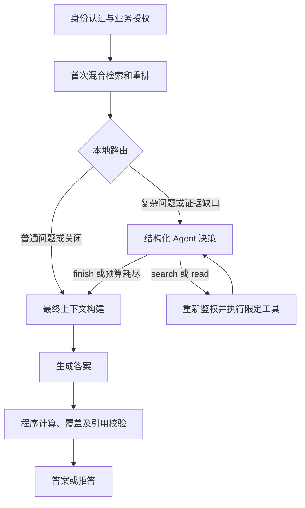

# 有预算约束的 Agent 证据收集

## 当前实现位置

`AnswerService.answer()` 通过 `EvidenceCoordinator.collect()` 先执行原有混合检索与重排。
普通问题直接返回首轮证据；需要比较、多要点、跨时期或首轮无正文证据时，进入有限模型决策循环。
最后仍由原来的 ContextBuilder、AnswerService、受限计算器、覆盖和引用校验决定答案是否可以返回。
Agent 不生成最终答案，不修改校验规则，也不能将缺证据改判为通过。



这是一个单 Agent 的结构化动作循环，不使用多 Agent、任意代码执行或新的向量后端。
本地路由只决定是否值得增加模型调用，不判断证据真假。Agent 根据当前证据决定下一个动作，
循环、参数校验、身份和预算由程序控制，因此区别于只按固定 if/else 重试检索。

## 动作与工具边界

| 动作 | 模型可提供的参数 | 后端行为 |
| --- | --- | --- |
| search | 一个不超过 400 字符的 query | 复用原有向量 + BM25 + RRF + 重排，在固定授权范围内补查 |
| read | 当前证据池中的 E 编号 | 回查该锚点的当前版本，最多读取前后各两块，共五块原文 |
| finish | 无 | 停止证据收集；后续仍必须生成并校验答案 |

模型不能传 tenant_id、知识库 ID、任意文档路径、SQL、URL 或管理员凭据。未知字段、
不匹配的工具参数、未见锚点及重复查询会终止补查。finish 不表示答案已经完整或正确。
计算继续由原有 `compute()` 在生成后校验来源、单位、顺序和前提并执行；首版没有给 Agent 增加计算工具。

## 权限与版本保证

- API 验签并授权后，将 actor_user_id 和原 external_subject 放入请求局部审计上下文；模型不能设置这些值。
- 每轮决策、工具执行前后和最终证据输出前，读取当前有效用户、租户、知识库及业务授权。
- 新授权不会扩大本次固定 RetrievalScope；原范围中有撤权、账号停用、知识库停用或身份重绑定时，停止本次请求。
- 没有可信 actor 的直接内部调用保留首轮链路，跳过 Agent；不根据提问内容猜测身份。
- Agent 的输入和最终输出都回查 SQL 当前 ready 分块及 vector_generation。模型输入中不使用检索器提供的伪造正文，更新或删除后的旧证据会丢弃。
- read 只能读取当前池中已有锚点的相邻内容，继续限定租户、知识库、文档、版本和 ready 状态。

授权与文档版本检查按各阶段 SQL 回查时点判定，最终生成使用本次已验证的证据快照。
不能撤回已经发送给模型的上下文；不宣称零时间窗口的即时撤销或生成期间实时同步更新。

## 默认预算与关闭方式

| 环境变量 | 默认值 | 含义 |
| --- | --- | --- |
| AGENTIC_RAG_MODE | auto | off：原单次检索；auto：本地路由；always：受控调试时强制尝试 |
| AGENT_MAX_DECISIONS | 2 | 最多两个决策模型调用 |
| AGENT_MAX_SEARCHES | 2 | 包含首轮检索，总共最多两次混合检索 |
| AGENT_MAX_READS | 1 | 最多一次相邻原文读取 |
| AGENT_MAX_EVIDENCE | 24 | 合并后的最大分块数 |
| AGENT_MAX_PROMPT_BYTES | 12000 | 决策提示词、可见证据和结构化 schema 的 UTF-8 字节预算 |
| AGENT_MAX_OUTPUT_TOKENS | 384 | 每次决策模型输出上限 |
| AGENT_MAX_DECISION_TOKENS | 16000 | 决策阶段累计用量预算，调用前按字节及输出上限保守预留 |
| AGENT_MAX_SECONDS | 20 | 首轮检索之后的可选证据收集时间预算 |
| AGENT_DECISION_TIMEOUT_SECONDS | 8 | 单次决策请求最大配置超时，且不超过剩余阶段预算 |

已知调用用量按供应商报告累计；未知用量按本次保守预留计入控制预算，不视为免费。
预算控制数不是供应商账单或精确 tokenizer 计数。字节预留包含 schema 和消息封装余量。
额外检索的 embedding 和 rerank 费用另外记在原有阶段，其次数由工具轮数限制。
这些限制不覆盖原来首轮检索、最终答案生成及多轮问题改写的全部 Token。

阶段超时会阻止继续派发工具，SDK、嵌入、Milvus 和重排按剩余预算收紧请求超时；
在途 SQL 与底层网络超时仍可能使实际耗时略超过阶段预算，不是强制取消所有阻塞工作的硬实时保证。
每次请求通过 ContextVar 隔离超时，不修改共享客户端配置；不会影响其他租户请求。

关闭时在 `.env` 设置 `AGENTIC_RAG_MODE=off`，重新创建 API：

```powershell
docker compose up -d api
```

修改代码需构建部署，单改配置需重新创建容器而非只 restart。无需迁移 SQL 结构或重建向量。

## 合并、上下文和降级

证据按租户、知识库、分块及 generation 去重。补查/补读与原证据交错排序，保留首轮首条证据，
同时给补充内容留出每来源四块预算中的位置。这只是有限排序，不冒称一次新的重排。
合并后按原问题重新做适用性选择，最后仍受原有 12000 字符和每来源四块的上下文限制。
E 编号仅供 Agent 选择工具，最终资料编号由 ContextBuilder 重新生成，防止跨轮引用编号漂移。

Agent 输出格式错误、可选工具失败或预算耗尽时，使用已获得并重新确认有效的证据继续原链路。
权限错误与关系数据库错误不能通过回退旧证据绕过；无证据时由原流程拒答。
这不修复 coverage 索引或数字/日期校验的既有误拒答，不能保证引入 Agent 就提高答案准确率。

## 观测与测试

- 新增模型用量阶段 agent_decision，复用独立用量账本与供应商用量/定价快照；不保存凭据或隐藏推理。
- 非旁路请求的 timings 增加 agent_decision_ms、agent_tool_ms；普通响应不增加空字段。
- Prometheus 新增 enterprise_agent_runs_total、enterprise_agent_actions_total、enterprise_agent_seconds。
- opt-in trace 保存动作、原因分类、预算停止点和补查轨迹。首轮检索的 fusion/rerank 轨迹保留，补查单列 agent_retrieval，合并结果单列 agent_evidence。
- 补查中的模型事件同时计入父 trace，原问题与授权范围不会被补查问题覆盖。
- 当前快进合并与新分支只在本地进行，不包含推送或远端 PR。

测试覆盖旁路零额外调用、搜索/邻块循环、提示词与 Token 预留、时间和轮数上限、重复查询、
非法动作/参数、越权内容、撤权、身份重绑定、旧版本失效、SQL 权威正文、接口兼容性与请求间预算隔离。
真实集成使用专用 _test PostgreSQL 数据库和唯一 Milvus 测试集合；决定模型、嵌入和重排可替换为确定性实现，不产生模型费用。

## 2026-10-14 验收记录

先将 Milvus 认证改动提交为 `b765a67`（启用Milvus服务认证并隔离后台账号权限），
然后将 `codex/migrate-to-milvus` 快进合并到本地 main，并从该提交创建 `codex/agentic-rag`。

| 检查 | 结果 |
| --- | --- |
| 完整单元/API 回归 | 781/781，无失败、错误或跳过 |
| PostgreSQL / Milvus / Redis 真实集成回归 | 34/34，包含新 Agent 搜索、邻块与撤权用例 |
| 最终 Agent 工具真实集成复核 | 2/2 |
| 前端认证、会话和引用预览 | 19/19 |
| 已配置模型的合成结构化决策冒烟 | 3/3，完整证据 finish、缺少另一对象 search、章节索引 read |
| 部署模式与服务账号 | auto；最多两次决策、总共两轮检索；API 仍使用 kb_api |
| 已部署 readiness / indexing health | 均为 HTTP 200 |
| 已部署匿名问答 | HTTP 401，无模型调用 |
| 原 SQL 文档/当前分块及向量快照 | 54 份、470 个，数量匹配且向量和元数据逐条不变 |

合成冒烟成功的三次决策调用报告合计 1024 Token，金额因未配置核实单价而未知。
首次试验另有一次格式解析失败，供应商用量未取得，不计为零或免费。
发现部分兼容接口对未使用参数返回空字符串，现仅将未使用的空参数规范化为 null；
search/read 的必需参数和未注册字段仍严格拒绝。

原始证据在被 Git 忽略的 `data/ingestion-reports/agentic-rag/`：
`unit-tests.xml`、`integration-tests.xml`、`final-agent-integration.xml`、`model-smoke.json`、
`initial-model-smoke-failure.json`、`deployment-verification.json`。
临时 PostgreSQL 数据库与测试 Milvus 集合在验收后清理；不删除业务数据库或向量卷。

合成冒烟可显式复现（会产生模型费用，已有报告不会覆盖）：

```powershell
python scripts/verify_agent_decisions.py --allow-model-calls --output data/ingestion-reports/agentic-rag/new-model-smoke.json
```

这次没有执行新的完整 80 题评估或带有效 JWT 的真实问答性能验收。
SQL/Milvus 集成的嵌入、重排与决策使用确定性测试实现，真实模型冒烟只验证动作接口，
两者不能拼成真实端到端答案准确率。旧 68/80 报告属于 Agent 引入前版本，不能直接视作本次实现的质量成绩。
