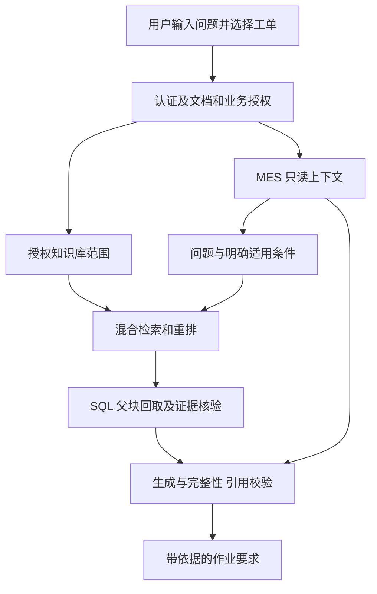

# 制造业工艺知识与作业指导项目实施方案

编制日期：2026 年 10 月 28 日。状态：完整规划保留；本轮按用户选择先完成[小规模版本](MANUFACTURING_LITE.md)，其中不含 MES/ERP 接口。下文描述完整目标，并非当前功能清单。

将现有企业知识库改造为面向生产操作员、工艺工程师和质量工程师的工艺知识与作业指导助手。以四类复杂文档的解析、结构化切分、适用版本判断、权限隔离和引用溯源为核心，接入模拟 MES 的只读工单上下文，回答“当前任务应依据哪份文件，以及必须执行哪些要求”。

本方案的目标范围是单个模拟制造企业、机加工与尺寸检验场景。完整交付包含制造业语料、解析验证、知识问答、权限演示及模拟 MES 联调；ERP 作为后续扩展。小规模版本已补充语料与解析回归，实际入库、账号初始化、模型问答及 MES 联调的完成状态以小规模版本验收记录为准。

## 一 项目定位与范围

项目名称建议使用“制造业工艺知识与作业指导助手”。服务对象及任务如下。

| 用户 | 主要任务 | 系统输出 |
| --- | --- | --- |
| 生产操作员 | 根据工单查找适用指导书，确认作业准备、步骤及检查要求 | 带文档版本、适用条件和引用的作业要求 |
| 工艺工程师 | 查询工艺文件，核对工程变更和版本差异 | 原文支持的变更项、适用对象及时间条件 |
| 质量工程师 | 查找对应工序的检验项目、量具使用要求及复检规定 | 完整检查项目、条件与例外及原文位置 |
| 知识管理员 | 管理文件、索引、授权、来源和问答反馈 | 可复查的入库、授权与质量记录 |

首期完成三类能力：根据工单定位适用文件；跨指导书、检验规范和变更通知完整回答；核对新旧版本的适用条件。通用技术手册提供参考知识，模拟企业文件规定该企业的具体作业要求，二者在回答中明确区分。

另一个 IT 故障诊断项目继续展示日志与指标取证、多角色审阅、恢复、修复提案和审批执行。本项目不扩展质量异常根因诊断、故障修复、自动报工或质量放行，也不新增多角色 Agent。公共的认证、预算、审计和观测能力继续复用。

## 二 当前能力与开发差距

以下现状依据当前仓库代码及文档，制造业语料和新接口均属于拟开发内容。

| 模块 | 当前已有 | 本次需要补充 |
| --- | --- | --- |
| PDF | 版面与表格提取、阅读顺序启发式、保守页边清洗、OCR、页码范围 | 用实际制造资料验证型号、单位、脚注和跨页条件；明确图示无法可靠解析的范围 |
| DOCX | 按正文顺序遍历段落和表格、标题与列表识别、完整行切表并重复表头 | 验证原生作业指导书、长检查表和条件列表；识别复杂表格及修订痕迹的限制 |
| Markdown | 标题、列表、表格和代码围栏识别 | 补充工艺知识条目、变更说明与结构混合样本 |
| TXT | 标题、列表、FAQ 和段落识别，按 UTF-8 读取 | 补充交接记录样本，明确编码失败与缺少标题的处理 |
| 检索与生成 | 混合检索、重排、SQL 父块回取、引用与覆盖检查、有限修复和拒答 | 制造对象及适用性元数据、工单上下文、领域测试题 |
| 权限 | 多租户、部门及个人的知识库授权、检索与回取复核 | 新演示租户及角色配置；MES 业务数据访问范围 |
| 业务版本 | 文档编号、版本、生效区间、状态及适用范围提取 | 产品、工序、工艺路线和明确的变更适用条件 |
| 证据与反馈 | 文档引用、原文预览、问答快照、反馈及评测闭环 | 工单来源、字段及时间引用；业务上下文的快照权限 |
| 系统集成 | Agent 证据动作限定为 search、read、finish | 独立的只读 MES 连接器与上下文获取服务 |

已有解析是规则和启发式实现，不表示任意版面都能正确理解。现有 OCR 待复核标记不会自动阻止 ready 文档参与检索；现有计算器主要处理时间和金额，不直接承担制造公差、单位换算或良率计算。

参考实现：[文档切分说明](DOCUMENT_CHUNKING.md)、[父子块说明](PARENT_CHILD_RAG.md)、[PDF 解析](../backend/app/documents/pdf_splitter.py)、[DOCX 与公共切分](../backend/app/documents/document_splitter.py)、[文本切分](../backend/app/documents/text_splitter.py)。

## 三 业务样例与演示路径

使用模拟企业“衡川精密”、产品 HC-A17 和 HC-A18、工序 OP-10 和 OP-20，以及两版作业指导书构建业务关联。名称、编号、企业规则与记录均为合成设定；具体数值在语料编制阶段确定并冻结，不从公开手册推定企业已批准的参数。

| 用例 | 提问示例 | 必要信息 | 通过表现 |
| --- | --- | --- | --- |
| 工单选版 | WO-017 当前工序应使用哪版指导书？ | 工单型号、工序、业务时间，指导书及变更适用条件 | 给出版本和选择依据；条件不明时指出缺口 |
| 完整检查清单 | 首件确认要检查哪些项目，有哪些前置条件？ | DOCX 检验表、作业条件与例外 | 列齐必答项，保持型号、单位、表头和备注对应 |
| 变更比较 | 1.0 与 2.0 版的首件确认要求有什么变化？ | 两版正文、明确的替代或变更关系 | 分别引用版本，说明变化及适用条件 |
| 事件触发要求 | 交接记录显示更换过定位治具，还应执行哪些确认？ | TXT 中的已记录事件、相应作业规则 | 区分已发生的事件、要求执行的步骤和实际执行状态 |
| 缺证据 | 资料没有覆盖这个产品，能否直接采用相近型号要求？ | 已有资料的适用范围 | 不把相似型号的规定当作该型号的批准依据 |

演示顺序为：登录选择工单，查看上下文，提问，查看答案和来源，切换历史时间或用户身份再次验证。文件本身的格式和来源可在证据预览中查看，正常业务页面不要求用户理解切片或向量参数。

## 四 语料收集与目录设计

### 4.1 首批规模

首批准备 16 份逻辑文档，另外增加 4 份可追溯的受控变体。不同业务修订版作为不同版本文件登记，同内容的格式转换副本不计作新的业务知识。

| 格式 | 数量 | 计划内容 | 来源 |
| --- | ---: | --- | --- |
| PDF | 6 | 4 份技术与测量资料，2 份模拟扫描作业补充文件 | 官方公开资料及自编模拟资料 |
| DOCX | 4 | 指导书 1.0、指导书 2.0、检验规范、工程变更通知 | 自编原生 Word 文件 |
| Markdown | 3 | 工艺知识条目、作业 FAQ、版本适用性登记 | 官方网页衍生内容及自编资料 |
| TXT | 3 | 三份不同日期或工单的班次交接与作业确认记录 | 自编模拟记录 |
| 合计 | 16 | 覆盖文件版本、长表、条件、跨文档关联与权限 | 按文件分别记录来源 |

4 份受控变体从有编辑和变换权限的自编文件生成，例如图片型 PDF、轻度倾斜扫描件、带页边噪声副本和长表跨页副本。它们用于配对测试，默认不与原件一起上传同一问答范围，也不作为独立业务文档扩大样本量。

### 4.2 公开资料候选

| 入口 | 可选内容 | 使用方式 |
| --- | --- | --- |
| [山特维克可乐满钻削知识](https://www.sandvik.coromant.cn/zh-cn/knowledge/drilling) | 工艺考虑因素、刀具和应用条件 | 选取与场景相关的条目，保留原始链接和条件 |
| [三丰精密测量仪器指南](https://www.mitutoyo.com/literature/quick-guide-to-precision-measuring-instruments/) | 测量工具及使用知识 | 从官方入口选择资料，核对型号和版本 |
| [三丰量具资料 PDF](https://www.mitutoyo.com/webfoo/wp-content/uploads/D_section.pdf) | 型号、规格表、单位、脚注及尺寸图文字 | 作为复杂 PDF 候选，逐页确认可解析内容 |

以具体下载文件为准确认标题、版次和许可。来源网址公开不直接证明允许再分发全文；采集清单保存使用条件，仓库优先发布来源、哈希、标注和自编资料，第三方全文按明确许可处理。遇到登录或下载限制时使用官方允许的获取方式。

### 4.3 拟新增目录

下列目录和脚本为后续开发目标，本方案不创建它们。

```text
sample_docs/manufacturing/
  README.md                 # 来源、模拟设定、上传与授权映射
  manifest.json             # 文件、哈希、格式、来源及适用性
  documents/                # 唯一可上传的业务资料
    common_reference/
    process_engineering/
    quality_guidance/
    production_handover/
  validation/               # 人工事实标注与解析检查，不上传
  variants/                 # 受控变体，不默认入库
evals/manufacturing/
  single_turn.jsonl
  permissions.json
  integration_cases.json
  annotation_guide.md
scripts/
  collect_manufacturing_sources.py
  validate_manufacturing_corpus.py
```

先人工筛选样本再开发采集脚本。脚本从审核后的 URL 清单获取文件，设置超时与请求频率，校验内容类型和哈希，保留原件。正文抽取产物另存并关联原哈希，不覆盖来源文件。变更语料时同步更新 manifest、标注及索引版本。

## 五 四类文档解析与切分实施

### 5.1 复杂文档样本矩阵

| 编号 | 格式与问题 | 需要保护的信息 | 验收重点 |
| --- | --- | --- | --- |
| PDF-01 | 规格表、型号和脚注混排 | 型号、参数名、数值、单位、限定备注 | 不串型号，不把分辨率与精度混为一项 |
| PDF-02 | 重复页眉、目录及正文换行 | 正文条件、独立数字、章节边界 | 去噪不删除重复业务规定和关键数字 |
| PDF-03 | 跨页段落或条件列表 | 引导句、全部条目、例外及页码范围 | 不让下一页内容失去所属条件 |
| PDF-04 | 自编文件的模拟扫描件 | 编号、日期、正负号、小数及单位 | 真正运行 OCR，记录待复核状态与实际错误 |
| DOCX-01 | 段落与表格交替 | 说明、表格和后续限制的顺序 | 保持原文阅读顺序与章节归属 |
| DOCX-02 | 长检查表、多级表头或合并单元格 | 检查项与适用对象、单位、备注的对应关系 | 普通长表按完整行切分；复杂表格不能误报为已正确恢复 |
| DOCX-03 | 编号步骤、条件引导句及例外 | 必要前提和连续步骤 | 绑定同章节规则列表，超长时保留关联 |
| MD-01 | 多级标题、列表、表格及围栏示例 | 结构归属和原始文字 | 不把示例中的井号或竖线识别成正文结构 |
| TXT-01 | 不规则换行、编号与交接段落 | 工单、事件、时间及原始顺序 | 不跨不同工单或班次拼接事件 |
| TXT-02 | UTF-8 BOM、CRLF、GBK 或不明编码 | 原始字节、中文、型号和单位 | 支持范围清楚，失败不能变成乱码成功入库 |

“脏”分为版面噪声、识别或编码错误、业务版本混杂。前两类在解析与校对阶段处理；新旧规定同时出现通过适用性判断解决，不在清洗时直接删除历史版本。

### 5.2 开发顺序与处理规则

先使用现有解析器检查首批资料，建立错误样例，再针对可复现问题修改代码。保留 structured-v4 作为改造前对照，不为固定题目添加企业名称、题号或参考答案特判。

PDF 继续按页选择原生提取与 OCR，保留章节、页码及解析方式。重复页边内容保守处理，数字、条件和否定不得仅因重复而删除。图中含关键步骤而现有链路不能可靠识别时，将对应要点标为未覆盖；图片附近的文字不能证明图示语义已被理解。

DOCX 继续遍历原生段落和表格，优先处理普通长表和明确条件列表。复杂合并表头、文本框和未接受修订须检查实际内容：无法恢复时给出可观察的限制，要求经过人工确认的发布副本，不承诺自动消解 Word 修订语义。

Markdown 保留标题路径、列表、表格和代码围栏。官方网页转换时仅移除确认的导航、广告等非正文内容，保留注释、条件与来源；翻译另存并关联原文，不以翻译替代数值和单位的原始证据。

TXT 首先维持 UTF-8 和 UTF-8 BOM 支持。GBK 等输入先报告明确编码问题；后续如增加转码，采用显式编码和严格解码，输出规范化副本并记录转换，不以忽略字节或替换字符完成“修复”。对没有明确边界的记录不猜测分组，至少保留文档及原顺序。

切分复用标题、段落、表格、列表、FAQ 和 rule_group。大表按完整行组织并重复表头；条件引导句与同章节列表绑定。超长规则采用关联子块及 SQL 父块回取，预算不足时仍执行原有完整性与拒答规则。父块来源于已解析正文，不能补救 OCR 漏字或表格错配。

### 5.3 OCR 校对与问答准入

自编扫描件保存独立人工原文及关键字段标注，标注文件不参与解析与检索。真实 OCR 输出与标注对照后，纠正记录绑定文件哈希、页码及精确原片段，复用现有校对机制；更换文件或 OCR 输出变化后重新核查，不全局替换相似字符。

一期使用人工验收与发布清单控制：未复核的扫描件只进入离线测试目录，校对完成且关键字段通过后再上传问答库。该流程不是现有程序的自动拦截能力。若后续开放自助扫描件上传，应先增加独立的证据准入状态，并在向量、关键词、父块、邻块、引用预览和快照访问中一致执行。

## 六 来源 版本与适用性元数据

在现有 metadata_json 内使用命名空间扩展，先确定数据契约，再按实际筛选需求增加结构化列和索引。采集清单不会自动传递到后端，需明确实现导入映射及服务端校验。

| 分组 | 字段示例 | 约束 |
| --- | --- | --- |
| 来源 | source_kind、source_url、publisher、retrieved_at、sha256、usage_terms、derived_from_sha256 | 区分 public_original、derived_public、synthetic_business 和 controlled_variant |
| 业务版本 | document_family_id、document_code、business_revision、effective_from、effective_to、supersedes | 只有明确来源才能声明替代与生效关系；未知值保留未知 |
| 适用性 | product_models、operation_codes、route_revisions、plant_codes、applicability_text | 保存原文依据；单值与列表使用固定结构，不用全文模糊匹配代替确定关联 |
| 解析质量 | parser、page_start、page_end、section_path、chunk_type、quality、ocr_corrections | 延续现有字段；DOCX、MD、TXT 不虚构物理页码 |

同一文件重新索引的 document_version 或 vector_generation 描述技术发布版本，不等于工艺业务修订版。需要同时回答历史问题的两版指导书分别保留可检索文件身份，通过 document_family_id 关联；不能只覆盖旧文件后声称仍能追溯历史正文。

选择资料时先限定授权范围，再依据明确型号、工序和业务生效条件筛选。上传日期、检索排名及版本号大小不单独决定适用性。两份仍适用的规则没有明确优先或替代关系时说明冲突；适用信息缺失时，不断言文件适用于当前工单。

## 七 权限设计

创建独立演示租户及测试身份，复用当前用户、部门和知识库授权。新身份使用独立的 Keycloak subject，不将既有用户改绑到新租户。默认设置通用参考、工艺工程、检验指导、生产交接四个库，按实际任务分配跨库权限。目录名称不自动创建授权，公共参考也仍受后端显式范围控制。

| 身份 | 示例读取范围 | 示例维护范围 |
| --- | --- | --- |
| 操作员 | 通用参考、获授权的指导书与检验要求 | 无 |
| 工艺工程师 | 通用参考、工艺工程及所需交接资料 | 工艺工程库 |
| 质量工程师 | 通用参考、检验指导及获授权工艺文件 | 检验指导库 |
| 外协测试用户 | 单独授权的对外资料库 | 无 |
| 知识管理员 | 明确授予的知识库 | 相应知识库管理 |

当前权限粒度主要到知识库。若必须在同一库内按工厂或产品隔离文档，需另行扩展并验证；一期采用独立知识库满足明确的隔离需求。产品型号、产线和文档版本首先是业务适用条件，是否也是保密边界由业务规则决定。

MES 另建 BusinessScope，至少包含租户、源系统和允许工厂，均由后端授权计算。工单必须属于该范围，指定其他工单号不能扩大权限。文档范围继续使用 RetrievalScope，两个范围分别验证；拥有知识库 admin 不自动获得 MES 权限。

问答、引用预览、对话历史、工单快照、用户共享反馈和评测样本导出均检查当前授权。未授权正文与业务字段不能先进入模型、日志或快照后再依靠界面隐藏。跨库问题缺少必要权限时，只依据当前可访问资料判断可回答性，不暴露被隐藏文件的敏感标题或内容。

## 八 MES 接入及问答链路

### 8.1 首期连接器

首期仅接模拟 MES 的 get_work_order_context，输入工单标识，返回工厂、产品型号、工序、工艺路线、相关业务时间、源记录编号及更新时间。业务时间按已登记的适用规则选取；计划时间不能替代实际时间，缺失时保留缺口。

用户选择工单后，由服务端确定性获取上下文，再进入现有知识检索与 Agent 补查。Agent 继续负责知识证据的 search、read、finish，不增加业务诊断角色。业务接口调用使用明确参数和调用预算，模型不能指定身份、租户、数据库或任意目标 URL。



工单查询需处理认证失败、超时、无记录、撤权、返回字段缺失、并发更新及响应截断。保留 fetched_at、source_updated_at 和源修订标识；开始与交付前核对记录是否变化，无法确认一致性时要求重新查询，不承诺跨系统事务快照。缓存结果明确标记时间，不把旧快照描述为当前状态。

如果问题必须依赖工单上下文而 MES 不可用，继续拒答并说明缺少的条件。一般技术知识问题可以在不依赖工单的独立问答模式回答，界面明确检索范围。

### 8.2 引用和会话契约

文档证据保留现有文档、章节、子块和父块身份；新增工单证据记录源系统、实体类型、记录编号、引用字段、值、查询时间及源更新时间。生成器只能引用后端登记的证据标识，校验时同时检查权限和字段支持关系，不让业务记录伪装成已入库文档。

建议新增 /api/manufacturing/qa 入口包装工单获取与现有问答流程，复用 answerable、claims、coverage 和拒答约束；旧 /api/qa 保持兼容。必要条件缺失时不得用部分肯定答案绕过原有契约。对话及反馈的快照模型增加业务来源范围，当前仅记录知识库的快照实现需同步扩展。

### 8.3 ERP 后续扩展

仅在“物料规格或修订决定适用作业文件”的场景得到验证后增加 ERP 的只读物料上下文。明确 MES 与 ERP 编码映射、规格版本、单位、时间及授权；真实厂商接入需要相应适配器和契约测试，不能仅替换地址后宣称兼容。首期不接库存承诺、采购下单、BOM 修改或生产状态写入。

## 九 代码和界面工作项

以下为拟修改或新增位置，存在的模块按最小必要范围调整，拟新增模块的具体命名在开发时确定。

| 位置 | 实施内容 |
| --- | --- |
| backend/app/documents/ | 四格式制造样本验证、可复现解析修复、来源与适用性导入 |
| backend/app/documents/policy_metadata.py | 制造适用性字段及显式元数据验证；保留原场景兼容 |
| backend/app/knowledge/ | 接收可信工单上下文，筛选适用证据，扩展业务引用与校验 |
| backend/app/security/ | BusinessScope、源系统授权与当前权限复核 |
| backend/app/integrations/（新增） | MES 连接器、认证、字段映射、时限及错误契约 |
| backend/app/manufacturing/（新增） | 工单上下文获取与问答编排，不承载异常诊断工作流 |
| backend/app/api/manufacturing.py（新增） | 制造问答及受控工单上下文查询 |
| backend/app/quality/ 与 backend/app/db/ | 业务证据、快照访问、反馈及导出范围；需要时添加 Alembic 迁移 |
| backend/app/static/ 与 backend/app/api/frontend.py | 工单选择、上下文卡片、来源和质量提示；新静态资源同步登记白名单 |
| scripts/ 与 evals/manufacturing/ | 采集清单、语料验证、制造题集、解析与集成检查 |

保留现有同源前端。页面包含工单选择、产品与工序摘要、问题输入、答案、适用版本和证据预览。当前“质量工作台”管理问答质量，名称明确为问答质量审核，避免让用户误认为其执行制造产品的检验或放行。

## 十 测试与评测设计

### 10.1 标注与数据划分

每份样本标注必要事实和原文位置，包括型号、字段名、数值、单位、条件、例外、章节，以及适用时的页码。表格以“型号或对象、参数、值、单位、备注”的组合标注，不能仅检查数字是否出现。扫描件保存独立人工对照原文，校对记录与参考答案分开。

准备 40 道单轮题：事实与型号查询 12 道、表格与条件完整性 8 道、跨文档问题 8 道、版本与变更问题 8 道、资料不足题 4 道。开发集 16 道、冻结测试集 24 道；按作业文件家族和任务划分，避免同一题的改写和受控变体跨分区。公共参考文档可共用，但合成题集仍称制造业回归集，不称独立企业黄金集。

另建 12 项权限检查和 8 项 MES 失败或变化场景，与 40 道问答题分别报告。现有权限评估包含原场景专用配置，需适配新身份和来源范围，不能只复制旧 JSON 后宣称已覆盖制造权限。

权限检查使用以下固定矩阵，每项拒绝场景同时配置一个合法访问正例。用于验证拒绝的专有事实不能在该用户可读的其他资料里存在等价副本。

| 编号 | 检查场景 | 预期 |
| --- | --- | --- |
| ACL-01 | 跨租户查询文件或工单 | 在读取正文与业务字段前拒绝 |
| ACL-02 | 未授权知识库的列表、检索与直接文档读取 | 不返回受限内容 |
| ACL-03 | 伪造父块或邻块标识 | 按租户、知识库和当前版本复核并拒绝 |
| ACL-04 | viewer 上传、修改或删除文件 | 后端拒绝，原文与索引不变 |
| ACL-05 | 跨库问题依赖未授权事实 | 不借助隐藏资料补答或泄露其内容 |
| ACL-06 | 查询其他工厂的工单 | BusinessScope 在调用及响应检查中生效 |
| ACL-07 | 请求中伪造身份、租户或工厂范围 | 后端授权范围不受客户端覆盖 |
| ACL-08 | 请求期间撤销必要授权 | 交付前复核，不交付受限证据 |
| ACL-09 | 撤权后打开既有文档与工单引用 | 按当前权限拒绝预览 |
| ACL-10 | 撤权后读取历史会话和证据快照 | 不通过历史入口绕过授权 |
| ACL-11 | 共享反馈审核及回归样本导出 | 同时满足相关文档与业务来源权限 |
| ACL-12 | 将其他工单的证据标识绑定到当前问题 | 验证记录及字段绑定，拒绝伪造引用 |

MES 集成至少覆盖以下 8 项，通过 HTTP 模拟服务触发，而不是仅使用返回固定字典的单元测试。

| 编号 | 检查场景 | 预期 |
| --- | --- | --- |
| MES-01 | 服务不可达或响应超时 | 有限失败，不超过请求总预算 |
| MES-02 | 上游认证失效 | 明确未取得上下文，不泄露认证信息 |
| MES-03 | 工单不存在 | 不采用其他工单或相似编号补齐 |
| MES-04 | 缺少型号、工序或适用判断必需的业务时间 | 保留缺口，依赖该字段的问题拒答 |
| MES-05 | 上游返回范围外工单或错误实体 | 响应进入模型前拦截 |
| MES-06 | 获取后源记录发生变化 | 复核修订，重新获取或要求重新查询 |
| MES-07 | 只有过期缓存且无法刷新 | 显示历史时点，不回答为当前工单状态 |
| MES-08 | 响应结构错误、超长或截断 | 按契约拒绝，不把残缺响应当完整事实 |

### 10.2 分层检查

| 层级 | 检查内容 | 结果含义 |
| --- | --- | --- |
| 文件与清单 | 哈希、格式、来源、许可记录、版本、预期文件清单 | 文件和来源完整，不等于解析正确 |
| 解析 | 关键字段组合、阅读顺序、表格对应、OCR 原文和错误 | 标注范围内的内容保真情况 |
| 切分 | 表头、单位、条件和例外的关联、父块覆盖、超长处理 | 结构与必要证据是否保住 |
| 检索与上下文 | 证据召回、首位命中、适用性及完整证据覆盖 | 检索与上下文表现，不直接等于答案正确 |
| 答案 | 完整语义、引用支持、版本判断、误答和误拒答 | 逐题交付质量，保留自动代理分与复核分 |
| 权限与集成 | 越权、撤权、直接 API、引用、快照、超时、缺字段及源变化 | 对应边界测试的通过与失败 |

现有离线 parsing 层主要检查结构和证据锚点，需要在制造验证器中补充组合字段和条件完整性断言，不能把原有锚点命中率直接称为完整解析准确率。OCR 工具缺失、样本未覆盖或复核未完成时明确记为未测试或未通过。

### 10.3 对照实验

首先对同一解析正文比较普通定长切分与结构化切分：固定模型、问题、检索参数、重排及预算，父块展开配置保持一致，观察表头、型号、条件和例外保留。需要比较解析器本身时另开实验，不能同时更换解析、切分、父块和提示词后把收益归于单一模块。

首期不强制新增 Agent 策略实验。若要报告 Agent 选工具或补查的收益，应使用相同授权、输入数据和工具的固定流程作对照，并记录实际动作。文档问答与新增 MES 数据的对照只能说明上下文接入的价值。

冻结题目、标准、语料哈希、授权范围及配置后运行，保留失败题和全部输出。性能记录完整请求的耗时、模型用量、工具次数及错误；没有业务用户参与的计时实验，不声称节省了实际工程师工时。

### 10.4 初始验收目标

下表是待实施的目标，必须在正式测试前冻结，不能当作已有成绩。

| 项目 | 初始要求 |
| --- | --- |
| 语料 | 16 份逻辑文档和 4 份变体全部有来源、哈希及分组，参考答案未入库 |
| 关键解析事实 | 标注的型号、关键数值、单位、条件及例外全部正确保留；未解决样本不得宣称支持 |
| 核心演示 | 第三节各用例按标准完整通过 |
| 冻结问答测试 | 24 道测试题至少 21 道完整语义通过；4 道资料不足题全部置于测试集并正确拒答 |
| 权限 | 12 项全部通过；任一越权阻止交付 |
| MES 边界 | 8 项全部符合预期，失败和旧数据不伪装为当前成功结果 |
| 原项目回归 | 相关原有测试通过，旧题集及验收记录未改写 |

如果未达到目标，交付失败分析和待修复清单，保持未验收状态。不能通过删除失败题、放宽标准或只重跑成功结果达标。由于样本较小，达标也只表示这套冻结测试通过。

## 十一 实施阶段和交付门槛

阶段按依赖顺序推进，不预先假定所有公开资料和版面都可用。

| 阶段 | 工作 | 交付物 | 进入下一阶段的条件 |
| --- | --- | --- | --- |
| P0 业务与样本设计 | 确定工单字段、版本适用规则、16 份文件清单及标注规则 | 数据字典、来源清单、用例和开发测试划分 | 每个用例有明确数据来源，公开与模拟内容可区分 |
| P1 四格式解析验证 | 获取和编写资料、生成变体、解析检查、人工核查 | 文档包、manifest、解析报告、问题清单 | 关键事实及来源可复查，未支持样本单独登记 |
| P2 制造知识问答 | 导入元数据、配置独立租户及授权、实现版本适用性和界面 | 无 MES 的制造知识问答演示 | 文档检索、引用、权限和历史版本用例通过 |
| P3 MES 工单上下文 | 模拟服务、连接器、业务授权、引用和快照扩展 | 工单选择与上下文驱动问答 | 正常调用及 8 项边界通过，跨系统来源可检查 |
| P4 冻结验收 | 切分对照、40 题运行、24 题冻结测试及权限检查 | 报告、逐题输出、失败分析、演示脚本 | 达到第十节目标，保留原项目基线 |
| 后续 ERP | 按物料规格场景增加只读适配 | ERP 连接器及独立集成验收 | 有明确使用场景和接口条件，再单独排期 |

每阶段的代码变更、语料版本和测试报告绑定。P1 或 P2 的成果可以独立演示；只有 P3、P4 完成后，才将模拟 MES 上下文接入写成项目已实现能力。

## 十二 验证入口和现有数据保护

已有的单文件检查入口如下，只读取本地文件，不生成向量或调用模型。替换为实际文件的绝对路径后执行。

```powershell
.venv\Scripts\python.exe scripts\inspect_document_chunks.py "D:\path\to\sample.pdf"
```

制造目录和题集创建后，可复用现有统一评估入口执行离线解析。以下是未来执行模板，路径必须已创建并符合现有 manifest 和题集结构；--ocr 需要实际 OCR 运行环境。

```powershell
.venv\Scripts\python.exe scripts\evaluate.py system --mode offline --dataset-dir evals/manufacturing --corpus sample_docs/manufacturing --layers parsing --ocr --strict
```

上述离线 parsing 命令不能替代组合字段、条件保真和人工版面检查。新增验证器的命令行契约在 P1 实现后记录，不预先提供无法执行的参数。

解析相关修改优先运行现有 tests/test_pdf_splitter.py、tests/test_documnet_splitter.py、tests/test_text_splitter.py、tests/test_ocr_review.py；版本、授权和父块修改分别覆盖对应现有测试及新增集成边界。真实问答评测继续通过现有显式模型调用入口并配置制造身份；业务数据验证需要真实认证，不能用绕过授权的服务调用代替。

制造语料使用新目录、独立题集和独立授权范围。部署或入库前保存当前授权、文件与索引清单，沿用候选文件和新 generation 发布流程；失败时保留可用版本，不删除现有卷或覆盖旧语料。新元数据与页面优先采用兼容扩展，关闭制造入口后原知识问答仍可运行。

项目验收材料包括：语料及来源说明、四格式解析与切分报告、元数据和授权设计、MES 接口契约、冻结题集、真实运行输出、权限与故障验证、部署与演示步骤。业务原文和含授权内容的 trace 按当前项目规则保管。

## 十三 项目表述与成果证据

完成后可围绕“多格式复杂文档处理、版本与条件完整性、权限隔离、工单上下文集成、分层评测”介绍项目。描述模拟企业和模拟 MES 的真实范围，不将它们写成真实工厂生产部署。

原软件企业语料上的历史成绩不作为制造业结果。[2026 年 10 月 22 日完整语义对照](CONTEXT_COMPARISON_20261022.md)已经说明，原文保留完整仍可能发生条件遗漏；制造验收必须检查最终答案中的条件和例外，不能只以证据召回或关键词通过判定业务正确。

简历和演示中的文档数量、准确率、耗时及改善幅度，均从本次冻结报告读取。四格式文件存在、解析成功、关键事实保留、检索命中和完整回答分别报告，避免把不同阶段的通过混为一个准确率。
