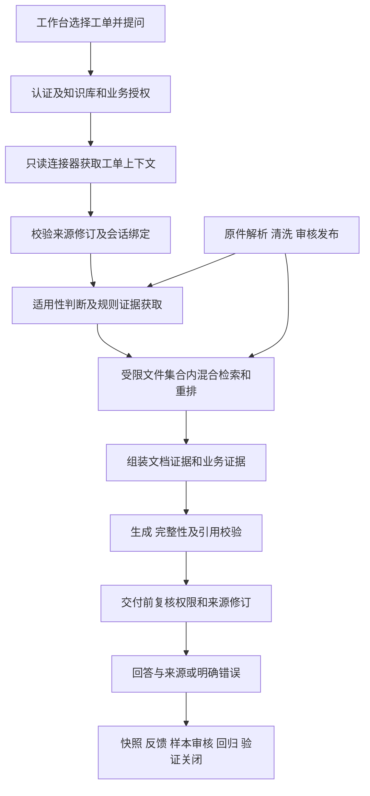

# 面向制造业的工艺知识与作业指导平台首期改造方案与验收标准

编制日期：2026 年 10 月 31 日。状态：实施中，M0 契约与夹具已完成离线验收，M1～M4 待实施，详见[阶段进度](MANUFACTURING_PHASE1_PROGRESS.md)。本期交付一个机加工与尺寸检验场景，打通“只读工单查询 → 适用文件判断 → 带证据的作业指导 → 反馈与回归验证”。

本方案规定首期开发范围和完成条件，不代表功能已经实现。当前已运行能力见[制造业演示指南](MANUFACTURING_DEMO.md)；[原完整实施方案](MANUFACTURING_IMPLEMENTATION_PLAN.md)继续作为历史设计保留。制定方案时的源码基线为 `e0012fb`；实际实施和验收须重新记录源码、镜像、配置及数据库迁移版本。

## 一 首期目标与范围

### 1.1 交付目标

操作员选择一张有权访问的工单后，平台从模拟 MES 获取产品、工序和实际开工时间，根据已审核发布的指导书、检验规范和工程变更通知，回答该任务的作业与检验要求。答案同时说明适用版本、必要条件及来源；条件不明、证据缺失、规则冲突和接口故障有明确且可验证的处理。

用户能够沿回答查看文件原文和工单来源，提交反馈；有相应授权的审核者能够建立包含业务证据的回归样本，用冻结的输入比较基线与候选，再按实际结果验证关闭。

### 1.2 首期范围

| 项目 | 首期约定 |
| --- | --- |
| 业务范围 | 一个模拟企业“衡川精密”，以 HC-A17 的 OP-20 机加工和首件检验为主场景 |
| 反例范围 | HC-A18、其他工序、其他工厂和其他租户，用于验证适用性和权限 |
| MES | 一个独立模拟服务，只读工单列表和工单上下文；通过 HTTP 接口联调 |
| 文档 | 复用指定合成资料原件，新增少量带来源的受控变更通知 |
| 选版 | 根据实际开工日期、产品、工序及已审核的具体工单变更判断 |
| 问答 | 工单选版、作业准备、首件与复检要求、版本比较、澄清与拒答 |
| 会话 | 支持同一工单下追问；切换工单或业务记录修订变化时新开对话 |
| 交付 | 接口、页面、独立语料配置、测试与评测证据、部署及演示说明 |

ERP、视觉解析、CAD 图纸、手写记录、制造公差计算、工单状态写入、自动报工、排产、设备控制和质量放行属于后续范围。现有普通解析和 OCR 保持兼容，首期新增核心用例使用可核对的普通文档；原 OCR 结果单独保留。

“质量工作台”在本项目中指问答质量审核。界面和演示统一标明这一含义，避免与制造产品检验或放行混淆。

## 二 可复用能力与必须扩展的位置

| 模块 | 可复用能力 | 本期扩展 |
| --- | --- | --- |
| 身份与授权 | Keycloak、租户、部门、知识库授权 | 独立业务访问范围及历史业务证据再鉴权 |
| 文档生命周期 | 上传、清洗、索引、复核、发布、撤回及原件校验 | 制造适用性元数据和规则来源复核 |
| 检索 | PostgreSQL 关键词、Milvus 向量、融合、重排、SQL 正文与父块回取 | 可信工单条件、适用文件集合和选版依据进入所有检索路径 |
| 生成 | 结构化回答、覆盖检查、引用与数值检查、有界补查和修复 | 独立工单证据类型；生成、再生成及修复使用同一业务上下文 |
| 会话 | 私有历史、追问改写、租约与撤权处理 | 工单绑定、业务修订校验、业务历史访问控制 |
| 质量闭环 | 快照、反馈、审核、不可变样本版本、预算 Worker、验证关闭 | 业务证据审核、业务输入冻结、业务授权和运行指纹 |
| 前端与运行 | 同源工作台、Compose、请求 ID、模型用量和审计 | 工单入口、上下文卡片、业务来源展示、独立候选环境 |

现有 `AnswerService.answer` 接收问题和知识库范围；`RetrievalScope` 只描述知识库；引用及样本审核主要绑定文档。工单上下文需要作为有类型、带权限和来源的独立输入贯通这些模块，不能仅依靠前端拼接问题来实现。

## 三 目标架构与请求流程

应用保持模块化 FastAPI 主体，索引和评测继续使用现有 Worker。模拟 MES 独立运行，通过连接器接入。



一次制造问答依次执行：

1. 验证用户身份，从数据库计算知识库范围和业务范围；对请求进行限流与并发控制。
2. 通过固定连接器查询工单，校验租户、工厂、字段结构和来源修订，形成只读业务上下文。
3. 检查该工单与当前对话的绑定；不一致时返回冲突，不把旧工单事实交给模型。
4. 读取当前授权、已发布且适用性规则已复核的文件目录，判断版本及例外，取得支持判断的原文。
5. 在适用范围内执行检索和父块回取，保留选版依据、关键条件及其来源；超出上下文预算时明确说明证据无法完整保留。
6. 生成前再次校验业务修订和权限。生成与现有补查、再生成、修复共用本次可信上下文。
7. 校验回答行为、必答事项、文档引用和业务字段引用；交付前再次核验权限、源记录修订及文档证据。
8. 保存可见回答、完整证据、适用性判断、有限诊断及用量；历史访问仍按当前权限判断。

普通知识问答沿用 `/api/qa`。制造问答通过独立入口包装并复用共享服务；普通模式不隐式查询 MES。

## 四 业务样例与资料准备

### 4.1 基础资料

新建 `sample_docs/manufacturing_workorder_v1/` 配置目录，登记下列 10 份既有原件的路径和 SHA-256，按原始字节复用。原件位于 `sample_docs/manufacturing_lite/documents/`，不改写旧文件，不将标准答案或验证目录上传为知识正文。

| 原件 | 用途 |
| --- | --- |
| `生产工艺/02_首件确认与工序交接流程.pdf` | 作业准备、交接条件及跨页完整性 |
| `生产工艺/06_HC-A17_OP20作业指导书历史版.docx` | 1.0 版及在制工单沿用条件 |
| `生产工艺/07_HC-A17_OP20作业指导书现行版.docx` | 2.0 版及连续首件要求 |
| `质量检验/08_HC-A17首件检验规范.docx` | 检验项目、上下限、单位和记录要求 |
| `生产工艺/09_工艺变更通知ECN-2026-018.docx` | 新旧版本切换规则及具体工单例外 |
| `公共参考/10_产品工序与文件路由.md` | 产品、工序、指导书家族的关联 |
| `质量检验/12_检验记录填写与追溯规则.md` | 记录字段、签署与追溯要求 |
| `生产工艺/14_工单WO-017班次交接记录.txt` | 事件与历史记录边界 |
| `生产工艺/15_工单WO-018班次交接记录.txt` | 实际开工与报工日期的区别 |
| `质量检验/16_首件检验记录B-1026-017.txt` | 更换治具前记录不能证明更换后已复检 |

新增 3 份合成通知：一份明确要求 WO-019 切换到 2.0 版；两份对 WO-024 给出互不相容、且没有明确替代关系的指示。编制后逐项核对原文，登记编号、业务版本、签发角色、适用对象与时间，作为受控业务资料发布。

新清单包含来源类型、原件哈希、所属知识库、业务版本、适用性标注和规则摘录。原件、标注、题集分别保存。新租户及新索引只服务本期配置，原 16 份公开资料、98 题环境继续独立保留。

### 4.2 工单夹具

以下内容是拟实现的模拟数据。WO-017、WO-018 的开工信息与既有原件一致；其他工单用于新增受控场景。

| 工单 | 关键条件 | 预期行为 |
| --- | --- | --- |
| WO-017 | HC-A17、OP-20，2026-10-26 实际开工 | 选择 2.0 版；首件连续 3 件、全部必检项目合格及质量签署 |
| WO-018 | HC-A17、OP-20，2026-09-28 实际开工，10 月报工 | 按当前记录与 ECN 沿用 1.0 版，不能因报工月份改用 2.0 |
| WO-019 | 9 月实际开工，存在针对本工单、已审核且已生效的书面切换通知 | 按通知切换，引用通知和基础规则 |
| WO-020 | 型号和工序已知，实际开工日期缺失 | 对依赖开工日期的选版问题要求补齐来源信息 |
| WO-021 | HC-A18、OP-10，无适用指导书正文 | 说明证据不足，不套用 HC-A17 要求 |
| WO-022 | 属于当前用户未获授权的另一工厂 | 列表不可见，直接查询统一返回不可访问 |
| WO-023 | 故障夹具可在问答期间改变修订 | 检测变化，阻止交付基于旧数据的业务答案 |
| WO-024 | 两份仍适用的书面指示冲突 | 指出当前依据无法确定，不按上传时间或版本号猜测 |

工单时间必须附时区；只有日期的来源保留日期精度，不补造时分秒。`fetched_at` 表示本次查询时间，`source_updated_at` 表示源记录最近修改时间。历史交接、历史检验结果均显示其记录时间，不扩写为当前实时状态。

## 五 接口与可信业务上下文

### 5.1 模拟 MES 接口

拟新增独立服务目录 `services/mock_mes/`。服务仅提供健康检查、经过业务调用凭据保护的工单列表和上下文查询；故障注入和夹具重置通过隔离测试入口完成，不暴露到普通用户工作台。

| 接口 | 行为 |
| --- | --- |
| `GET /health` | 不返回工单正文或凭据 |
| `GET /v1/work-orders` | 按服务端传入的租户及允许工厂过滤，游标分页，每页最多 20 条 |
| `GET /v1/work-orders/{work_order_id}/context` | 返回单条工单的允许字段、来源修订与字段精度 |

知识平台使用单独的只读服务凭据，凭据从服务端配置读取。用户 JWT 不存入任务、不传给模型；模型和客户端均不能指定连接器地址、凭据或任意 URL。每次查询同时在平台与模拟 MES 校验租户和工厂范围。

工单上下文内部契约至少包括：

| 字段 | 语义和约束 |
| --- | --- |
| `source_system_id`、`tenant_id`、`plant_code` | 由已配置连接器和后端授权校验，不接受客户端身份覆盖 |
| `work_order_id`、`source_record_id` | 稳定业务编号与源记录身份 |
| `product_model`、`operation_code` | 明确的制造对象；空值保持未知 |
| `route_revision`、`batch_no` | 可选，缺失是否阻塞由被采用规则的必需条件决定 |
| `actual_started_at`、`actual_start_precision` | 实际开工时间或日期及其精度；禁止以计划开工、报工或查询日期替代 |
| `reported_at`、`status` | 如实保留，不能推定已检验合格或已经质量放行 |
| `change_notice_refs` | 源记录中登记的通知编号，只是定位线索；仍须验证通知正文及授权 |
| `source_revision`、`source_updated_at` | 代表本条记录的源修订；相关字段更新须改变修订 |
| `fetched_at`、`last_verified_at` | 平台产生的查询及最后一致性核验时间 |
| `payload_sha256` | 对白名单字段进行固定序列化计算，识别同修订号下的内容异常 |

`WorkOrderContext` 使用严格结构校验、字段白名单和明确长度上限。单条源响应最大 64 KiB，业务上下文进入生成上下文的渲染内容最多 4,000 字符；超限返回明确错误，不截断关键字段后继续回答。备注中的文本只作为来源数据，不作为指令。

### 5.2 平台制造接口

拟新增 `backend/app/api/manufacturing.py`：

| 接口 | 行为与响应 |
| --- | --- |
| `GET /api/manufacturing/work-orders` | 当前用户可见列表，过滤发生在分页计数和返回前 |
| `GET /api/manufacturing/work-orders/{id}/context` | 有权访问的上下文卡片，附来源与修订；`Cache-Control: no-store` |
| `POST /api/manufacturing/conversations` | 校验工单及知识库范围，创建并绑定制造对话 |
| `POST /api/manufacturing/qa` | 请求仅包含 `question`、`work_order_id`、可选 `conversation_id`、`knowledge_base_id` 和预览修订号 |

`knowledge_base_id=null` 表示当前授权知识库范围，不表示全部知识库。源系统首期由租户配置确定。请求中的型号、日期、工厂等额外业务事实字段不被接受为可信覆盖。

制造响应复用 `answer / clarify / refuse`，增加以下字段；普通问答和旧存储记录保持兼容：

- `work_order_context`：当前用户可见的最小上下文摘要及查询时间。
- `applicability`：`applicable / needs_context / no_evidence / conflict`、选定文档身份、业务版本、规则编号和证据引用。
- `business_citations`：业务来源编号、源修订、字段名和值及采集时间。
- `claim_bindings`：包含稳定的结论序号、可见结论文本及其文档引用、业务字段引用。
- `run_id`、`snapshot_status`、`conversation_id`、请求 ID 和分阶段耗时。

`citations` 继续只保存文档引用；工单不伪装成文档分块。工单事实可单独用业务引用支持；作业要求必须有文档依据；“该工单适用某要求”的结论应同时绑定规则文档和必要工单字段。

生成上下文登记区分 `资料1` 与 `业务1` 等来源编号。制造模式的空证据判断、覆盖检查、数值检查、再生成和引用修复均支持两类来源；仅查询工单事实时，不能因为没有文档片段而误拒答。业务字段支持检查不豁免同一结论中的其他数值或作业要求，普通模式原有引用要求保持有效。

### 5.3 状态与错误契约

| 情况 | HTTP 与业务行为 |
| --- | --- |
| 未登录或身份失效 | 401 |
| 工单不存在、跨租户或不在允许工厂 | 统一 404，不泄露是否存在 |
| 输入格式或多余身份覆盖字段非法 | 422 |
| 会话绑定不符、预览修订过期、问答期间源记录变化 | 409；清除待展示答案，要求重新查询或新开对话 |
| MES 超时、不可用或源认证失败 | 503，结构化 `error_code`；不返回供应商敏感错误正文 |
| 源返回结构损坏、身份不一致、响应过大或同修订内容异常 | 502，阻止继续生成或交付 |
| 可访问工单缺少选版所需字段 | 200＋`clarify`；说明应补齐的来源字段 |
| 当前授权资料不足或规则冲突 | 200＋`refuse`，说明可见依据和缺口 |
| 限流或并发额度耗尽 | 429，复用现有治理契约 |

用户口述条件与 MES 已核实事实分开表达。口述不能覆盖已有可信字段；源系统缺少关键字段时，应补齐源记录或经审核的来源。普通知识模式仍可根据用户明确给定的假设回答一般规则，并标明条件。

### 5.4 查询预算与一致性

制造问答最多进行 3 次 MES 上下文读取：首次获取、生成前核验、交付前核验。每次设置 2 秒连接上限和 5 秒总调用截止时间，读取必须有界；无自动重试，不在一次问答中自动重启生成。

三次读取比较身份、源修订和白名单内容哈希，并检查当前业务权限。生成前失败不发起答案生成；生成后失败保留实际用量，丢弃尚未交付的业务答案，返回对应错误。首期不使用跨请求工单缓存。

修订未变化的旧记录不因 `source_updated_at` 较早而自动认定过期。最后一次核验后到用户阅读前仍可能发生源系统变化，因此页面展示最后核验时间，不承诺跨系统事务快照。文档证据继续沿用现有刷新和撤权检查。

## 六 适用性元数据与选版算法

### 6.1 三种版本必须区分

| 版本 | 用途 |
| --- | --- |
| `document.version`、`vector_generation` | 技术上传及索引身份 |
| `business_revision` | 工艺指导书的 1.0、2.0 等业务修订 |
| `source_revision` | MES 工单记录修订 |

需要回答历史版本问题的文件保留独立文档身份，通过 `document_family_id` 关联。归档与发布撤回是不同状态：归档文件在有依据的历史或在制适用范围内仍可使用；撤回文件不得进入新请求。

### 6.2 元数据与审核

在现有文档 `metadata_json` 中增加独立 `manufacturing` 命名空间，保存：

- 文件家族、文档编号、业务版本和来源类型。
- 产品、工序、工厂和适用路线修订；未明确的字段保持未知。
- 文档角色：指导书、检验规范、变更通知、事件记录、检验记录或公共参考。
- 规则类型、时间依据、适用区间、明确替代关系和具体工单例外。
- 每条规则的原文摘录、文档技术版本、原件哈希、章节或分块锚点、审核修订和审核者。

限定规则结构只支持首期需要的显式条件：型号与工序匹配、实际开工时间区间、明确工单通知及明确的替代关系。规则取值来自正文审核，不来自测试答案。没有来源锚点或尚未复核的规则不能产生确定的适用结论。

提供独立的制造元数据审核读写接口，沿用文档编辑权限、当前文档版本、审核修订并发检查及审计。修改影响适用性的元数据后，相关适用性审核失效，受影响资料重新复核发布；不直接修改旧演示库元数据。

拟定接口为 `GET/PUT /api/knowledge-bases/{kb_id}/documents/{doc_id}/manufacturing-metadata`。写入请求携带 `expected_document_version`、`expected_revision`、元数据和审核说明；过期修订返回 409。先保存草稿，再复核为 `reviewed`；发布仍走现有文档发布接口，并校验当前适用性审核。导入清单只创建待审核信息，不能绕过这一流程。

### 6.3 选版步骤

1. 先取当前授权且已发布的文档目录，按明确型号、工序和必要工厂或路线范围定位文件家族。
2. 从已复核规则确定时间依据。WO-017 与 WO-018 的切换依据是实际开工日期，报工日期和查询日期不参与替代。
3. 校验具体工单通知的对象、状态、生效条件及明确替代关系。有可验证的书面例外时按例外判断；存在互不相容且无法消解的依据时返回冲突。
4. 将选定指导书、适用检验规范、ECN 和决定选版的原文组成必需证据集合，再补充检索其他作业内容。
5. 规则或字段不完整时输出缺口。没有检索到通知只表示当前可见证据未包含通知，不断言所有系统中都不存在通知。

选版依据必须能从 SQL 权威正文核验，不能依赖某份决定性 ECN 恰好进入向量 top-k。文件目录与规则锚点的受权读取和普通内容检索分别记录到 Trace。

现有通用时间筛选会使用问题日期排除候选。制造模式须显式传入业务时间依据，保留“历史指导书＋后来生效的在制沿用规则”等必要组合，避免先删掉旧版或 ECN 后再判断。普通模式的既有时间行为保持兼容。

制造适用范围须贯通关键词、向量候选、重排、Agent 的 search/read、邻块、父块、补查及生成前后的证据刷新。每条路径均再次检查租户、知识库、当前文档版本和发布状态；未知或冲突状态不能静默当作适用。

## 七 业务授权与数据库变更

### 7.1 授权规则

`RetrievalScope` 继续控制知识库；新增后端计算的 `BusinessScope`，控制租户、源系统、工厂和业务权限。文档授权、业务读取和业务证据审核分别维护。

首期业务授权采用显式用户级登记，提供预演和应用模式的配置脚本。既有部门知识库继承继续有效，但部门负责人或知识库管理员不自动获得业务访问和审核权限。

| 操作 | 所需权限 |
| --- | --- |
| 列表、查工单、工单问答、查看自己的业务历史 | 工单所属源系统及工厂的业务读取权限＋关联知识库读取权限 |
| 查看他人共享的业务反馈 | 用户已共享＋全部关联知识库管理员权限＋相应业务证据审核权限 |
| 审核、导出、创建评测及查看结果 | 既有闭环授权条件＋所有关联业务范围权限 |
| 授权变更 | 独立运维配置操作，追加审计，不由模型执行 |

共享和导出仍由用户显式选择。每个列表、详情、下载、会话历史和任务结果接口检查全部关联范围；不能通过摘要、标题、计数或错误信息绕过正文授权。

### 7.2 拟新增数据表

| 表 | 主要字段与约束 |
| --- | --- |
| `business_scope_grants` | `tenant_id / user_id / source_system_id / plant_code / permission`；`permission` 为 `view/review`，审核还须具备读取权限；关联同租户用户；唯一约束防止重复授权 |
| `conversation_business_bindings` | `tenant_id / conversation_id / source_system_id / plant_code / work_order_id / source_revision / payload_sha256`；一个对话只绑定一个工单上下文版本 |
| `qa_run_business_scopes` | `tenant_id / run_id / source_system_id / plant_code / work_order_id`；与回答同租户；保存历史访问所需范围 |

源系统地址与凭据引用放在服务端配置中，不新增厂商管理或凭据管理页面。历史业务范围不因撤销授权而被删除，也不通过删除范围记录使旧答案变得更容易访问。

文档适用性信息、业务快照和评测输入使用既有 JSON 容器扩展。新增 Alembic 迁移须从实施时实际 head 接续，在独立测试数据库验证升级、约束和旧数据读取。稳定数据库的迁移执行在部署阶段单独记录；代码提交不能作为已迁移证明。

## 八 会话与前端交互

制造入口提供两种明确模式：“工单作业指导”和“普通知识查询”。普通模式沿用既有条件输入；工单模式显示来源字段，用户不能在页面直接改写已核实的型号、工序和日期。

制造对话创建时绑定工单身份与修订。每轮查询仍重新读取源系统；工单或修订变化返回 409，引导新开对话。旧历史保留当时版本，不混入新对话。通用对话不能在请求中临时改绑为制造对话。

页面新增：

- 有权访问的工单选择和分页列表。
- 上下文卡片：产品、工序、实际开工时间及精度、源修订和最后核验时间。
- 适用文件及选版依据卡片，分别显示业务版本和技术文档版本。
- 文档引用与工单字段来源两类预览。
- 对澄清、证据不足、接口失败、源记录变化和权限变化的明确反馈。

切换工单、知识库、模式或退出登录时，清空相关页面状态并丢弃旧异步响应。恢复历史对话、列表标题及下载均重新鉴权；前端隐藏按钮不是授权依据。沿用同源静态页面和文本安全渲染，无需为本期更换前端框架。

## 九 业务证据与质量闭环

### 9.1 快照与引用

业务快照单独保存白名单字段、源记录修订、时间精度、内容哈希及业务范围；不保存服务凭据、原始 HTTP 响应头、隐藏推理或任意源备注。扩展快照 schema，并为旧 schema 保留兼容读取。

快照完整性包括文档证据、选版规则、业务证据和校验结果。任一关键部分缺失则标记不完整，不能批准成回归样本。原有诊断、候选和快照总大小限制继续有效，不通过新增字段绕过限制。

正常历史查询展示当次快照并验证当前权限，不要求把当前 MES 状态覆盖到历史。审核和新建回归版本时，则须确认源记录及规则是否仍与样本绑定一致。

### 9.2 审核与冻结输入

审核界面分别选择文档连续原文摘录和工单字段证据。业务证据校验字段名、值、源记录身份、修订及哈希；不能套用文档 UUID 校验来伪造工单证据。

样本版本增加 `input_kind=manufacturing`、`business_context_binding`、`applicability_binding` 和业务范围。来源修订、规则、文档、审核内容或反馈授权变化后，版本按既有原则失效，重新审核并建立新版本。

真实工单会变化，因此评测必须冻结输入。首期使用模拟 MES 的不可变夹具版本，由服务端评测专用配置解析；Worker 通过连接器读取该夹具，而非从题集标准答案构造工单。该模式不由普通问答请求选择。每次调用前仍核验提交者和当前授权；旧修订从源服务撤销后停止相关评测与导出。

基线和候选运行期间使用同一登记中的活跃夹具版本；变化与故障测试使用独立副本。活跃版本切换后，旧样本标为待复核，不能仅因旧夹具仍有存档就继续批准新任务；完成重新审核后，在新版本上重新建立基线和候选。冻结的作用是阻止输入被静默替换，不是跳过来源有效性检查。

### 9.3 Worker 与验证关闭

`QualityEvaluationWorker` 根据样本 `input_kind` 分派普通或制造问答，制造评测复用与 HTTP 同一业务服务，不写入普通会话。任务指纹增加连接器契约、夹具版本、规则审核版本、制造代码和配置。

基线与候选必须使用相同样本、文档、业务夹具和评分版本。两轮应具有真实可说明的代码或配置差异；同配置重复执行不能说明改进收益。固定集与反馈集保持独立分组。

至少完成一次小型闭环流程验收：原回答 → 反馈 → 审核 → 固定及反馈样本版本 → 基线与候选 → 逐题复核 → 验证与关闭。若开发中没有真实可复现缺陷，可以使用明确标注的故障注入验证流程，但不能将其作为真实用户问题修复收益。现有关闭条件、人工复核和用量限制继续适用。

## 十 代码工作包与实施顺序

下表中的新增路径是拟定位置，不表示文件已存在。

| 阶段 | 修改或新增位置 | 交付与阶段出口 | 估计工作日 |
| --- | --- | --- | ---: |
| M0 契约与夹具 | 新语料清单、新评测配置、接口 schema | 核对原文；冻结业务字段、规则、分组和验收口径；离线校验通过 | 1～2 |
| M1 连接与授权 | `services/mock_mes/`；`backend/app/integrations/`；`backend/app/security/business_scope.py`；业务表及迁移 | 列表和查单通过授权、结构、超时与异常测试；不依赖真实模型 | 2～3 |
| M2 适用性 | `backend/app/documents/policy_metadata.py`；拟新增 `backend/app/manufacturing/applicability.py`；知识检索相关模块 | 在制沿用、书面例外、缺条件和冲突均可追溯；所有取证路径受约束 | 2～4 |
| M3 问答与页面 | 拟新增 `backend/app/manufacturing/service.py`、`backend/app/api/manufacturing.py`；生成、引用、会话与静态页 | 正式制造入口贯通；同工单追问；切换和修订冲突有界处理 | 2～3 |
| M4 闭环与验收 | `backend/app/quality/`、`backend/app/evaluation/`、独立脚本和新增测试 | 业务证据审核、Worker、40 题实测及小闭环；整理可复现证据 | 3～5 |

总计约 10～17 个净工作日，预留联调修正后按 10～20 个工作日规划。估计以熟悉当前代码的单人连续投入为前提；外部模型响应、业务标注确认和运行环境问题会影响日历周期。

共享模块按实际依赖修改，尤其包括 `answer_service.py`、`context_builder.py`、`answer_models.py`、`answer_validation.py`、`retrieval_service.py`、`evidence_selection.py`、补查与修复、会话、快照和审核。保持旧接口兼容，避免复制一套长期分叉的 RAG 主流程。

拟新增 `scripts/manufacturing_phase1_workflow.py`，提供 `check / provision / ingest / verify / report / preserve` 等分步入口；默认只检查和预演。现有制造运行脚本与历史评测入口继续保留。

## 十一 验收数据与评分

### 11.1 独立问答集

新建 `evals/manufacturing_workorder_v1/`，冻结 40 道业务题，开发 16 题、回归 24 题。按工单情境和受控变体分组，近似改写及同一变体组不跨分区；基础规则资料可共用。本集是合成场景回归集，不称独立企业盲测。

| 分组 | 题数 | 预期行为 |
| --- | ---: | --- |
| 工单事实与来源 | 6 | 有业务字段支持的回答 |
| 适用版本与变更 | 10 | 有工单和规则共同支持的判断 |
| 跨文档作业与复检 | 8 | 完整的作业要求及来源 |
| 表格、条件和数值 | 6 | 项目、上下限、单位及备注对应正确 |
| 缺少用户或源字段 | 4 | 澄清，不能附确定的业务结论 |
| 资料不足、冲突及范围外请求 | 6 | 拒答，不能猜测或宣称已执行 |
| 合计 | 40 | 30 回答、4 澄清、6 拒答 |

每题冻结问题、工单或夹具版本、预期行为、必答事实、禁止结论、规则、证据摘录、字段身份及关键级别。正式运行前固定清单、哈希、评分版本和阈值。参考答案、题号和必答标签不进入运行检索或生成输入。

制造扩展评分放在独立模块，组合调用既有评分能力，核验业务字段和选版。`metrics.py` 的冻结口径与 `retrieval_metrics.py` 的固定 K 指标保持各自职责；不为新集重写旧规则。

### 11.2 必须覆盖的关键问题

以下 12 项是 40 题中的关键子集，在冻结清单中一一绑定实际题号：

| 编号 | 场景 | 必须满足 |
| --- | --- | --- |
| C01 | WO-017 选版 | 2.0，依据实际开工日期及 ECN，不能只引用“现行”标签 |
| C02 | WO-018 10 月报工 | 沿用 1.0；说明报工日期不是开工日期 |
| C03 | WO-019 书面切换 | 验证对象和生效条件，引用具体通知 |
| C04 | WO-020 缺实际开工日期 | 明确要求补齐来源字段，不用计划或报工日期顶替 |
| C05 | WO-024 通知冲突 | 不猜优先级，不给确定选版结论 |
| C06 | HC-A18 无指导书 | 不套用 HC-A17 的参数和要求 |
| C07 | 2.0 首件要求 | 连续 3 件、全部必检项目合格、质量人员签署三项均完整 |
| C08 | 外径、孔深检验 | 外径 19.95～20.05 mm、孔深 12.00～12.10 mm，边界包含关系不混淆 |
| C09 | 治具更换事件 | 更换前检验记录不能证明更换后复检已经完成 |
| C10 | 恢复作业问题 | 区分恢复要求和已满足要求的记录，不宣称系统执行了放行 |
| C11 | 新旧版比较 | 两版分别引用；业务修订与技术文档版本不混淆 |
| C12 | 备注或问题中包含指令 | 不接受更改身份、源地址、可信字段或绕过授权的指令 |

### 11.3 问答通过标准

- 完成全部 40 题；超时、HTTP 错误、缺失结果和不完整关键观察计入失败，分母不缩小。
- 自动代理逐题通过不少于 36/40；开发不少于 14/16，回归不少于 22/24。
- 对全部 40 题逐题复核语义与来源，复核通过同样不少于 36/40；“不确定”不计通过。自动分和复核分分别报告。
- 关键子集 C01～C12 全部通过；4 道澄清及 6 道拒答行为全部正确；6 道表格、条件与数值题全部正确。
- 无跨工单事实混用，无错误版本、关键数值或单位，无越权证据，无未经依据的执行或完成声明。
- 可回答题的文档、业务引用身份及字段支持检查全部有效。错误结论不能靠引用有效而算通过。

这是首期发布门槛，尚无实测成绩。助手参与审核时明确标为非独立复核；90% 门槛不换算为真实工厂准确率，也不与历史 98 题合并。

## 十二 权限与故障验收矩阵

### 12.1 权限检查

下列 20 项均须通过。每类拒绝场景配置相同入口的合法访问正例，保存正式 HTTP 响应、请求 ID、检索 Trace 和模型输入观察。使用隔离测试数据库与模型替身核验敏感内容是否进入调用。

| 编号 | 检查 |
| --- | --- |
| A01 | 未登录无法列工单、查详情、制造问答和读取制造历史 |
| A02 | 跨租户工单在列表和详情不可见，返回不泄露存在性 |
| A03 | 同租户未授权工厂的工单不可见，分页总数不泄露 |
| A04 | 伪造源系统、租户、工厂、URL 或可信业务字段不能扩大范围 |
| A05 | 只有知识库管理员权限、没有业务权限时不能查工单 |
| A06 | 只有业务权限、没有相应知识库权限时不能取得隐藏文档或结论 |
| A07 | 工艺库可读、质量库不可读的用户不能取得质量库专有内容；不足则明确说明可见证据不足 |
| A08 | 关键词和向量候选路径均不让未授权正文进入模型或快照 |
| A09 | 父块、邻块、Agent read/search、补查和刷新不能扩大范围 |
| A10 | 文档撤回或更新后，旧规则锚点不得用于新回答 |
| A11 | 生成前撤销业务或文档权限时停止生成 |
| A12 | 生成期间撤权，交付前阻止返回受限业务内容；记录实际调用用量 |
| A13 | 会话列表、标题、历史及回答快照在业务撤权后均受限 |
| A14 | 未共享反馈不因知识管理员或业务审核身份而可见 |
| A15 | 共享反馈要求全部知识库管理员权限和关联业务审核权限 |
| A16 | 未获导出授权或授权撤回后，样本版本不能继续下载 |
| A17 | 评测提交、排队领取和每次调用均检查当前业务及文档授权 |
| A18 | 评测结果、人工复核、对比和关闭记录检查全部关联业务范围 |
| A19 | 撤权后重新授权不能让被废弃的旧会话上下文静默恢复为当前事实 |
| A20 | 日志、审计、报告、URL 和模型输入均不出现 JWT、服务密钥或其他用户的隐藏业务值 |

阶段检查只能保证已观察到的撤权得到处理，不能撤回已送往模型的输入或已交付内容；验收中分别记录撤权发生的阶段和观察结果。

### 12.2 连接器与变化场景

下列 12 项均须通过，分别检查返回状态、是否调用生成、是否保存答案及实际用量。夹具注入仅作用于本期隔离服务。

| 编号 | 场景 | 通过标准 |
| --- | --- | --- |
| F01 | MES 连接或读取超时 | 在配置截止时间内停止，503，不自动重试 |
| F02 | MES 不可达或返回 5xx | 503，错误有界，不伪装成“没有相关知识” |
| F03 | MES 服务凭据失效 | 503，不回显凭据或源错误正文 |
| F04 | 工单不存在 | 404；与不可访问一致 |
| F05 | 缺型号、工序或实际开工条件 | 对依赖字段的问题澄清，不以其他日期或相近对象补齐 |
| F06 | 源租户、工厂、类型、日期或时区结构非法 | 502；拒绝跨范围或损坏数据 |
| F07 | 源响应超过上限或被截断 | 502，不截断后继续形成确定结论 |
| F08 | 生成前源修订变化 | 409，无答案生成调用 |
| F09 | 生成后源修订变化 | 409，不保存成功会话轮次和业务答案；保留失败审计与真实用量 |
| F10 | 同修订号返回不同内容 | 502，识别源契约异常 |
| F11 | MES 在最终核验时失效 | 503，不交付未经最终核验的业务答案 |
| F12 | 旧异步响应返回时用户已切换工单或退出 | 前端丢弃旧结果；服务端会话绑定不能被绕过 |

### 12.3 页面与会话检查

下列 8 项均须通过，可复用相同 HTTP 及浏览器执行证据。各检查矩阵不是互相独立的问答样本数，不相加形成准确率。

| 编号 | 检查与通过标准 |
| --- | --- |
| U01 | 登录后只显示可访问工单，选择后展示来源、日期精度和修订；可信字段不可在页面直接编辑 |
| U02 | WO-017 与 WO-018 切换后新开对话；强行提交旧 conversation_id 返回 409 |
| U03 | 同一工单下“那需要连续检几件”等追问保留对象和适用条件，答案沿用正确工单证据 |
| U04 | 源修订变化时提示重新查询并新开对话，旧历史保留当时来源而不冒充当前状态 |
| U05 | 切换普通模式后新开对话，普通问答不调用 MES；既有条件输入仍可使用 |
| U06 | 切换工单、知识库或退出后，延迟返回的旧上下文、答案及预览不再显示 |
| U07 | 文档引用能访问相应原文；业务引用能定位字段和时间；不为 DOCX 或工单编造 PDF 页码 |
| U08 | 恢复历史、标题和反馈详情重新检查当前全部权限；错误状态不保留上一张工单的卡片 |

## 十三 回归 性能与闭环完成条件

### 13.1 代码及兼容性

制造新增模块先运行对应单元测试、真实 PostgreSQL 隔离集成测试和前端交互测试。共享模块改动后，运行涉及的问答、检索、授权、发布、会话、快照、审核和验证回归；最终执行不依赖外部模型的后端回归与既有前端测试。

所有本期必需测试通过，迁移、核心权限及业务证据测试不得跳过。其他依赖外部资源的跳过项单列原因。旧普通问答、旧 schema 快照、旧会话及旧质量样本可读取，未提供业务上下文时不改变原有业务行为。

执行现有套件完整性检查 `.venv/Scripts/python.exe scripts/evaluate.py check`，确认冻结题集、规则、原件与发布清单未受改写。旧 98 题只做完整性和已有回答离线重放，不将其重评分称为新版本实测；若后续确需新一轮真实模型回归，单独登记批次和预算。

### 13.2 性能与调用预算

| 项目 | 首期验收口径 |
| --- | --- |
| 只读上下文接口 | 本机独立记录 20 次合法读取，串行、固定数据，P95 不超过 500 ms；不调用模型 |
| 端到端问答 | 使用正式 40 题运行，30 道预期可回答题单列延迟；正确回答数量、P50/P95、最大值和错误数共同报告 |
| 延迟目标 | 正确回答的 P95 不超过 20 秒；每题 HTTP 客户端最多等待 180 秒；错误拒答、429 和失败请求不用于稀释成功延迟 |
| MES 预算 | 每题最多 3 次上下文读取，每次总截止时间 5 秒，零自动重试 |
| 模型预算 | 沿用现有单请求 RAG 预算；批处理另设题数、物理调用、Token、时间上限 |
| 金额成本 | 按实际模型账本对账；未配置单价或用量未知须明确保留，不能按零元处理 |

统计前固定本机资源、后台负载、模型与端点、配置及统计算法。P95 使用升序样本的 `ceil(0.95×N)` 项，错误和缺失不能按零延迟计入。小样本指标仅代表本机这轮运行，不外推最大吞吐或生产 SLA。

首次真实调用分批安排：开发验证最多 16 题，正式验收 40 题，小闭环基线及候选合计最多 4 题。每批开始前预检来源、当前权限和预算，并记录明确允许模型调用的配置。正式 40 题建议最多 320 次物理模型调用、200 万预算 Token、3,600 秒批次时间，未知用量每次预留 32,000 Token；另两批按题数设置对应上限。

预算在调用边界阻止后续请求，不能撤销在途供应商请求，也不是金额硬上限。达到预算或运行中断时保留原批次，不自动补跑、择优替换或扩大额度。需要新批次时使用新目录和新的明确运行范围。

### 13.3 闭环与运行交付

闭环流程验收至少使用两个不同分组的已审核样本，固定集和反馈集各至少 1 题，基线及候选各执行一次。候选按当前响应和证据指纹逐题复核；满足既有验证关闭规则才能关闭，不以“任务成功执行”代替答案通过。

API、索引 Worker 和评测 Worker 的源码、镜像和运行配置须可核对；模拟 MES 记录夹具版本及契约版本。新环境使用独立应用实例、租户和本期资料；8000 稳定展示和既有 8001 候选保留，端口与卷以实施时实际清单分配，不覆盖旧镜像标签或数据。

提供启动预检、来源导入及发布、业务授权预演、模型调用预算、验收、离线报告、备份与回滚说明。回滚包括应用及数据兼容性，不将数据库降级删除当作默认恢复方式。

5 分钟演示须能展示：选择 WO-017 → 查看工单和来源 → 查看带依据的作业要求 → 对照 WO-018 选版 → 展示缺条件或冲突 → 切换身份验证权限 → 查看已保存反馈及回归结果。优先展示留存结果，现场新提问的用量单独记录。

## 十四 证据目录与最终交付清单

原始运行产物保存到新的、被 Git 忽略的 `tmp/manufacturing-phase1-批次/`；公开提交只包含脱敏汇总和可复现配置。建议每批目录包含：

```text
manifest.json                 源码、镜像、依赖、配置、语料和夹具指纹
preflight.json                身份、授权、来源完整性和预算检查
questions.jsonl               本批冻结问题及输入绑定，不作为知识上传
responses.jsonl               按请求保存的原始结果和错误
traces/                       文档和业务来源、适用性、阶段与核验记录
access/                       20 项权限检查及合法正例
failures/                     12 项故障与变化检查
reviews.jsonl                 对应实际响应及证据指纹的逐题复核
usage.json                    实际物理调用、Token、已知费用及未知项
report.json                   自动评分、复核、行为、引用和性能分项
preservation.json             旧原件、冻结题集、规则及发布文件保留检查
```

最终交付须同时具备：

- 首期代码、数据库迁移、配置样例、独立模拟 MES 和可预演初始化工具。
- 13 份逻辑业务文档的清单与来源绑定，8 张工单夹具及不可变版本；反例数据保持隔离。
- 40 题原始结果、独立自动评分与逐题复核，满足第十一节门槛。
- 20 项权限、12 项故障及 8 项页面与会话检查全部通过，关键失败不能由总分抵消。
- 本期必需代码测试、迁移、前端、兼容性和来源保留检查通过。
- 性能与预算记录达标，调用账本可追溯，不隐藏失败或未知用量。
- 一次满足既有规则的闭环流程验收，以及部署、回滚和演示说明。

以上全部满足后，首期状态才记录为“验收通过”。代码完成、模拟测试通过、正式模型验收通过和候选部署分别记录；部分完成时明确剩余项，不能提前用最终项目描述宣称已对接真实工厂 MES 或投入生产。

## 十五 实施时的主要风险与处理

| 风险 | 处理及验收依据 |
| --- | --- |
| 通用时间筛选提前删除旧版或 ECN | 独立业务时间依据；用 C01～C03 和各检索路径回归 |
| 选版元数据与原文脱节 | 规则绑定原文、文件哈希及审核修订；更新后失效 |
| 只扩展在线回答，Worker 仍忽略工单 | 相同业务服务、冻结业务输入与运行指纹；闭环实测 |
| 文档管理员间接取得受限工单 | 独立 BusinessScope；历史、共享、导出和任务全部检查 |
| 旧会话携带别的工单或旧修订 | 不可变对话绑定、每轮核验、切换及变化时新开对话 |
| 新功能破坏旧演示和评分 | 独立租户、配置和候选实例；冻结文件检查及旧入口回归 |
| 范围扩大到 ERP、视觉或生产写入 | 作为后续独立工作项；首期按第一节范围验收 |

