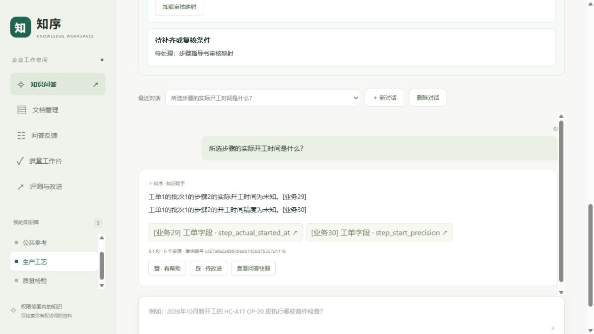
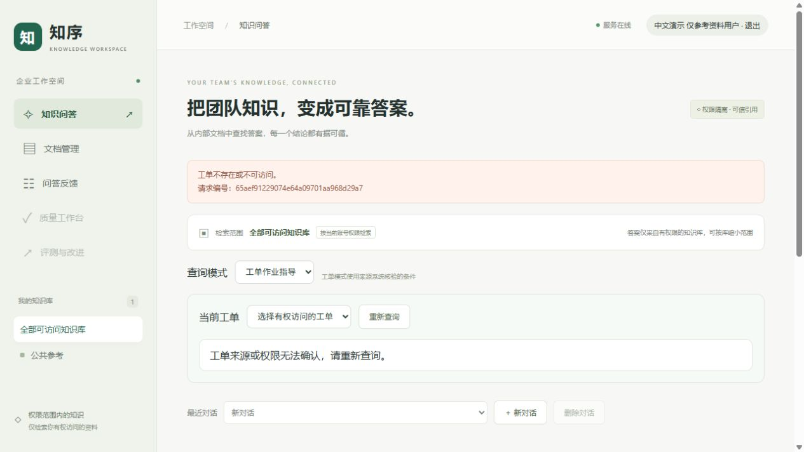

# 2026-11-10 制造工作台浏览器验收

结论：**主要浏览器工程链路走通，页面仍有3项待改进；本轮不构成整体质量或生产验收通过。** 已完成 OpenMES 选择、映射审核、字段问答、来源预览、会话恢复、反馈审核、冻结与零调用 Worker 的实际页面操作，以及 ERPNext 的执行选择页面检查。全部为助手非独立验收，自建记录不是真实工厂执行证据。

## 版本与方法

工作区为 `main / d3f70c7efc91aa398f044ed0fcc10b15e2dec415`。原 OpenMES 8004 仍运行 `609d23d` 的 `openmes-guidance-quality-20261110-r2`，ERPNext 8003 仍运行 E4 `2680ce0` 的 `erpnext-quality-20261109-r2`。本轮未改业务源码、更新镜像、迁移数据库、重建索引或重启原环境。

实际使用浏览器完成认证、选择、提交与结果回读。8003/8004 的企业登录通过 Keycloak OIDC；普通问答页面无法设置请求级零预算，因此临时使用**同一 OpenMES 镜像、原权限链、原数据库与原来源配置**的 8005 入口，在服务端对每个请求强制模型调用0、Token0。8005未注册OIDC回调，使用页面现有的临时访问令牌登录，不修改认证配置或权限。两次任务由正式 `--once --zero-model-calls` CLI执行，未启动常驻 Worker。8005验收结束已停止，最终结果在原8004回读。

## 页面检查

| 范围 | 实际结果 | 边界 |
| --- | --- | --- |
| 登录与知识库范围 | 8004和8003企业登录成功；管理员可见3个库 | 未修改权限或保存新凭据到公开资料 |
| OpenMES对象选择 | 选择工单1、批次1、步骤1；切换步骤2后时间保持未知 | 工单实际开工及唯一工序仍未知；批次、步骤不能代填 |
| 步骤指导书映射 | 草稿修订6、复核启用修订7；指定2.0/OP-20并保留旧历史 | 平台演示审核，不写MES，不从步骤名推定工艺编码 |
| 开工问答与业务引用 | 步骤1返回真实演示时间及datetime；步骤2返回未知；业务29/30预览可打开 | 确定性字段回答，无模型生成 |
| 文档来源 | 打开适用指导书2.0原文及选版依据 | 没有验证新的模型生成作业指导或模型文档断言 |
| 会话绑定 | 恢复历史工单/批次/步骤快照；重新核验开始新会话；切换步骤不串用已知时间 | 没有执行需要模型改写的普通追问 |
| 反馈与审核 | 主动共享、另行同意导出、选择实体身份/时间/精度证据，保存审核修订 | 新反馈及审核说明均标注助手非独立工程验收 |
| 样本冻结 | 创建两个追加版本；修改审核修订后旧版本显示已变化 | 未覆盖旧版本或历史失败 |
| 任务与复核 | 修订后的两题任务执行完成，固定/反馈各1题自动代理及助手非独立复核通过 | 是工程验证，不是模型准确率或真实改进闭环 |
| 只读与权限 | 登记开工请求被拒绝；仅参考资料账号只有公共参考，无质量审核入口，工单读取404 | 没有扩大权限或向上游写执行记录 |
| ERPNext页面 | 选择工单、具体工序和作业卡PO-JOB00008，分别显示9月28日工单/工序开工和10月26日卡开工 | 只读页面检查，未发送ERPNext问答 |

3个本轮成功问答快照均确认 `source_verified`、`document_scope_verified`、`business_citations_verified` 为真，`mes_reads=3`。包括只读拒绝在内，都保留来源和权限核验。

## 首轮停止及另建版本

首个任务 `de283df6-17b8-445f-9750-c56c54e45302` 使用我改写的“工单1的批次1的步骤1的实际开工时间是什么？”。当前确定性投影仅处理单实体问题，同时出现工单/批次/步骤会走模型解析；硬零预算在调用前停止，结果为 `EvaluationStopped`、完成0/2、物理调用0、Token0。该结果是预算边界验证，不计为两题回答错误，也不宣布整轮通过。

随后保留原问题“所选步骤的实际开工时间是什么？”，对象身份由冻结的工单1/批次1/步骤1绑定明确，追加审核修订3并新建版本 `0e4e60e9-e4a3-4d7f-997e-8578c4030ff0`。旧版本 `da520116-836c-4734-9e3c-5722b912128f` 和失败任务保留，不覆盖或拼分。反馈集仍使用另一工单2/批次3/步骤5的当前冻结版本 `b36ea631-a968-4642-a01c-0ccbe38db1d4`，未拆分同工单。

新任务 `78501462-49d2-4a1c-8de0-526ef6532453` 完成2/2，固定集返回步骤1已知时间，反馈集返回步骤5未知时间；自动代理分别1/1。两条复核明确注明助手非独立工程验收，数据库最终均为 `passed`。第二条复核首次未保存成功，最终在原8004重新提交并回读后才计入；没有把表单已编辑状态当作保存证据。

## 待改进项

| 编号 | 优先级 | 复现与影响 | 建议验收标准 |
| --- | --- | --- | --- |
| UI01 | P2 | 两条业务引用存在，底部仍显示“0个来源”；前端计数只读取文档citations | 分别标明文档引用与业务引用数量，和实际按钮一致；不得改变引用校验 |
| UI02 | P3 | 只读拒绝的answer与refusal_reason相同，页面重复展示整段拒绝文字 | 相同内容只展示一次，仍保留真实拒绝原因及请求编号 |
| UI03 | P2 | 原8004窄窗口innerWidth323时scrollWidth375，有横向溢出，详情阅读需横向滚动 | 补查窄窗口导航、工具栏、表单和详情；约定支持宽度内无页面级横向溢出，长哈希可换行 |

UI01对应 [app.js](../../backend/app/static/app.js) 的 `renderAnswer` 来源数量；UI02同函数同时显示answer与refusal_reason。窄窗口只记录实际323px观察，不推断所有手机尺寸失败；1280px检查无页面级横向溢出。本轮没有修改这3项或做完整响应式矩阵。

其他原始截图及SHA256见[结构化记录](browser-acceptance-20261110-r1.json)，包括业务引用、指导书原文、重复拒绝、ERPNext执行选择和原8004任务结果。

## 用量、留存与限制

临时8005入口记录119个API请求（111个200、7个201、1个预期404），请求预算汇总调用0、Token0；这不是8003/8004及Worker的总请求数。ERPNext和OpenMES两份独立数据库账本前后比对均无新增或缺失模型事件；失败和成功任务各自也记录调用0、Token0。

19个原ERPNext/OpenMES相关容器的ID、镜像、启动时间、运行状态和重启次数均与本轮基线一致；7份受检查旧公开报告哈希一致。候选库仍为OpenMES `e9b2d4f60713` / ERPNext `f2b8c0a961d3`，最终活动质量任务0、文档13、分块53。新增的是平台演示映射修订、会话、反馈、审核、冻结版本和任务；没有清理或回滚这些审计数据。

本轮补齐了所列核心页面流程，未覆盖所有页面、所有浏览器、完整移动端矩阵、视觉解析、备份恢复、真实模型生成或真实工厂接口。ERPNext真实模型10/16、模拟开发13/16、正式31/40的旧失败状态继续保留，各轮不拼分；本轮零调用结果不能更新这些成绩。

私有原始记录、临时保护入口、账本及全部截图保存在 `tmp/browser-acceptance-20261110-r1/`，不提交凭据、令牌、配置和数据库快照。

交付检查：README、工作入口、阶段进度和本报告共147个本地链接有效；结构化记录的预算、任务状态、两条复核、三次来源校验及环境保留断言通过，7张公开原始截图哈希一致。仅新增验收文档与证据，没有重跑业务测试或付费问答。
