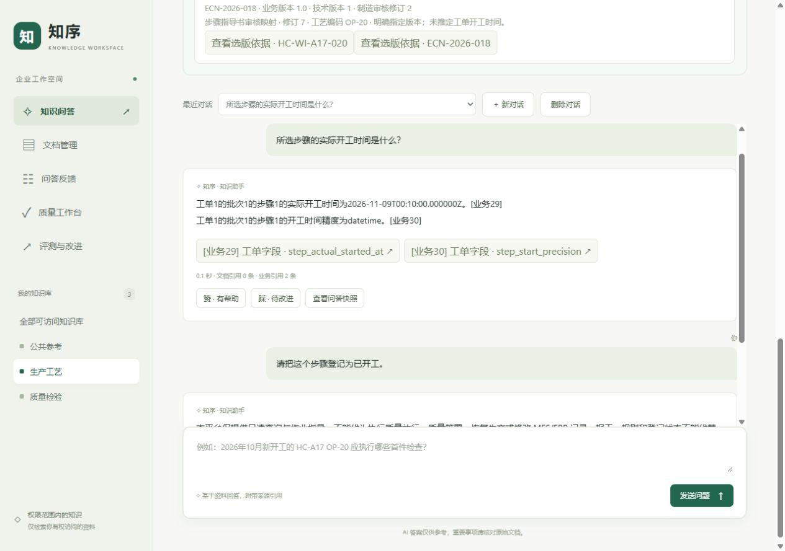

# 2026-11-10 工作台页面修复部署

已将 `f6a53ca` 的三项页面修复部署到实际 **8003 ERPNext工作台、8004 OpenMES工作台**，健康及浏览器冒烟检查通过。两个工作台分别基于各自原镜像应用相同页面补丁，保留原后端业务版本及模块依赖。

## 当前运行版本

| 工作台 | 当前镜像 | 保留的后端 | 页面修订 |
| --- | --- | --- | --- |
| [ERPNext 8003](http://127.0.0.1:8003/) | `enterprise-knowledge-manufacturing:erpnext-ui-20261110-r1` | E4 `2680ce0` | `f6a53ca`补丁 |
| [OpenMES 8004](http://127.0.0.1:8004/) | `enterprise-knowledge-manufacturing:openmes-ui-20261110-r1` | O4/O5 `609d23d` | `f6a53ca`补丁 |

新镜像仅复制修改后的 `app.js`、`styles.css`。ERPNext的167个、OpenMES的175个受检查应用文件中，只有这两份静态文件变化；后端源码及其余静态文件与各自部署前一致。环境变量、启动命令、挂载、网络及端口保持原值，镜像另以 `io.enterprise-knowledge.ui-revision` 标记页面修订。不能将页面修订号视为整个镜像的后端源码版本。

## 验证与留存

- 两个API容器均为Docker健康状态；`/health`、首页、公共浏览器配置为200，未认证的工单接口仍为401。部署资源字节、缓存及nosniff响应头通过核验，两份版本对应的JavaScript语法检查通过。
- 两边均通过企业OIDC登录。8004恢复既有开工答案及只读拒绝，显示“文档引用0条 · 业务引用2条”，拒绝提示只出现一次，业务字段预览正常。
- 8003选择工单、具体工序和作业卡PO-JOB00008，分别保留9月28日工单/工序与10月26日作业卡的开工时间。323px及1280px宽度冒烟检查无页面级横向溢出，浏览器控制台无错误。此前完整五档页面复验见[修复报告](frontend-fixes-20261110-r1.md)。
- 仅两个工作台API容器按部署预期重建；原53个容器基线中的其余51个ID、镜像、启动时间、状态和重启次数不变，包含ERPNext/OpenMES上游、适配器、数据库与其他保留环境。数据卷没有删除或替换。
- 两个候选数据库迁移版本、业务授权摘要及独立模型账本前后一致，新增模型调用0；没有新问答、审核、冻结、索引重建或常驻Worker。22份旧公开报告哈希不变，当前无活动质量任务。

本轮浏览器仅查询真实演示来源和既有问答快照，没有生成新答案或运行付费模型评测。ERPNext10/16、模拟开发13/16和正式31/40的旧失败状态不变，不拼分。原始镜像保留，未执行回滚或备份恢复演练。



## 本机启动与回滚

当前API重建时应叠加本轮镜像覆盖文件；上游及依赖沿用原启动流程。本机私有配置不随新克隆提供。

```powershell
docker compose -f tmp/erpnext-quality-20261109-r1/compose.json -f tmp/frontend-deploy-20261110-r1/erpnext-override.json up -d --no-deps api
docker compose -f tmp/openmes-guidance-quality-20261110-r1/compose.json -f tmp/frontend-deploy-20261110-r1/openmes-override.json up -d --no-deps api
```

回滚到原页面时，使用同一基础compose，移除本轮覆盖文件后重建API。基础文件仍指向旧镜像，单独使用它重建API会恢复旧页面。不要删除数据卷；本轮没有修改适配器或上游配置。

镜像完整ID、资源哈希、部署和浏览器证据见[结构化记录](frontend-deploy-20261110-r1.json)。准备、构建、部署、校验及回滚入口保存在 `tmp/frontend-deploy-20261110-r1/`，凭据和私有配置不提交。

交付文档166个本地链接有效，结构化部署断言、4份部署资源哈希及4张公开截图校验通过；本轮没有重跑既有模型或完整业务回归。
