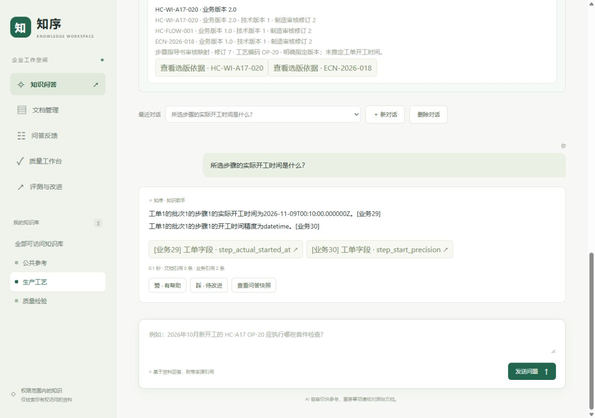
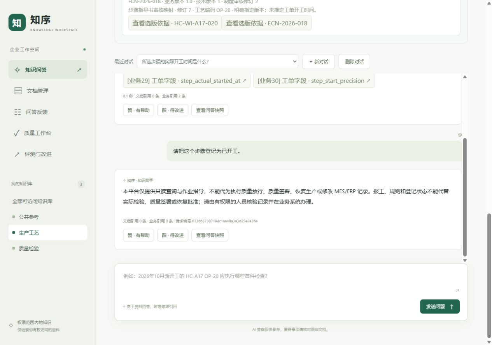

# 2026-11-10 三项页面问题修复与复验

结论：前次浏览器验收发现的**业务引用漏计、重复拒绝和窄窗口横向溢出已修复并通过本轮复验**。修改仅涉及共享工作台的 `app.js`、`styles.css` 和对应前端回归测试，后端权限、来源校验和业务规则不变。原ERPNext/OpenMES运行环境保留；修复在临时8005入口验证，未部署到原8003/8004。

## 改动与验收结果

| 问题 | 修复 | 验收 |
| --- | --- | --- |
| UI01：业务引用漏计 | 分别显示文档引用、业务引用条数，与各自引用按钮对应 | 真实步骤答案显示“文档引用0条 · 业务引用2条”；空引用、纯文档、纯业务和混合引用均通过回归检查 |
| UI02：重复拒绝 | 仅在拒绝原因与答案去除首尾空白后不同时追加原因 | 真实登记开工请求仍被拒绝，整段只出现一次；不同拒绝原因仍显示，并继续按纯文本渲染 |
| UI03：窄窗口溢出 | 窄屏导航分行，顶栏和工具栏换行，来源表单允许收缩；弹窗长字段/修订哈希换行，标题预留关闭按钮间距 | 320、323、375、768、1280px宽度下，所列核心页面最终均无页面级横向溢出；审核及评测详情内部也无横向溢出 |

没有添加页面级 `overflow-x:hidden` 来遮挡内容。文档表格仍允许在自身容器内横向滚动，长名称、源修订和证据保持可阅读。

## 验证范围

- `node --test tests/frontend_conversations.test.cjs tests/frontend/auth.test.mjs`：**67通过、0失败**。包括新增两组引用数量/拒绝展示回归，以及已有认证、权限变化、来源失效、会话选择和晚到响应保护。
- `.venv/Scripts/python.exe -m pytest tests/test_frontend_api.py -q`：**11通过**，覆盖静态资源、安全响应头、配置脱敏和禁止读取任意文件。首次沙箱内执行长时间无输出而中止，未查定原因；同组检查在提升执行权限后通过，未改断言。
- 实际浏览器使用真实OpenMES来源，生成一个步骤开工字段答案和一个只读拒绝；两个成功快照均确认三次来源读取，权限、文档范围和业务引用校验为真。恢复历史答案后仍正确显示引用数量，字段预览可打开。
- 仅参考资料账号只见公共参考，质量入口禁用、旧审核内容清空，工单读取返回404且列表无业务记录。业务授权数据库摘要前后相同。

五档宽度覆盖：制造问答与映射、文档管理、问答反馈、质量列表与冻结版本、审核详情、评测表单/任务列表、评测结果详情。浏览器保留51次尺寸记录，含中间定位和重复复查，**不将其作为51个独立业务测试或模型评分**。

初次改动先消除了导航撑宽，真实长批次及指导书下拉框仍溢出；为来源表单补充宽度约束后通过。业务引用弹窗也发现局部横向滚动，补充长文本换行；另为长审核标题预留关闭按钮间距并再次观察。这些中间记录保留在私有产物和结构化记录中，不以最后截图覆盖早期观察。

323px导航、字段预览、最终审核详情及权限页面截图与SHA256见[结构化记录](frontend-fixes-20261110-r1.json)。浏览器视口结束后恢复默认值，临时标签页关闭。

## 环境和用量

基于 `main / 41ea4a2` 开始修复。临时8005使用原OpenMES `609d23d` 的 `openmes-guidance-quality-20261110-r2` 镜像，仅只读挂载新的两个静态文件，服务端硬限制模型调用0、Token0；原认证、数据库及来源配置保持有效。浏览器取得的两个静态资源字节与本轮工作区一致，结束后临时容器已停止。

临时入口69个API请求的预算用量均为0；ERPNext和OpenMES独立数据库账本均无新增或缺失模型事件，业务授权摘要不变。原19个受检查容器ID、镜像、启动时间、运行状态和重启次数一致；原8004资源仍匹配修改前版本，20份旧报告哈希一致。无活动质量任务，未创建新审核修订/冻结版本、更新索引、启动常驻Worker或向上游写执行记录；仅新增平台会话和两个零模型问答快照。

这轮是页面及工程复验，没有付费模型验证，不更新旧ERPNext10/16、模拟开发13/16或正式31/40的失败状态，也不代表完整移动端兼容或真实工厂业务验收。原8003/8004继续运行原页面，Git提交与容器部署分别管理。

私有配置、令牌、原始快照、布局与运行对比位于 `tmp/frontend-fixes-20261110-r1/`；公开记录仅含自建演示证据，不提交凭据。

交付检查：README、工作入口、阶段进度和本报告共150个本地链接有效；结构化证据断言、两份静态文件及6张公开截图的SHA256校验通过，Git差异无空白错误。
