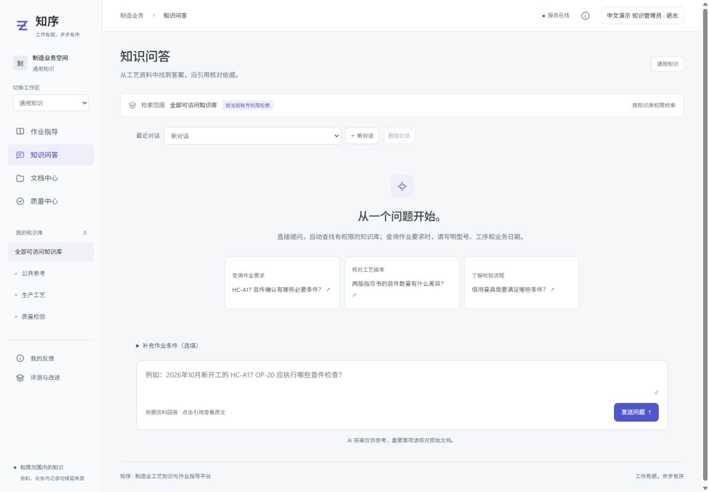
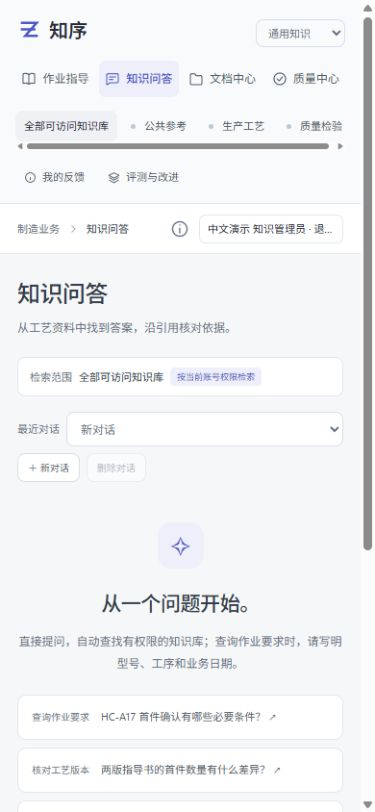

# 新版前端功能核对与8000部署

2026-11-16按用户要求，先核对原前端功能，再将新版发布到8000的通用、ERP、MES三个工作区。原功能入口保留，发现并修复了快速切页影响评测刷新、矮窗口压缩知识库列表两处问题。

## 当前版本

| 项目 | 结果 |
| --- | --- |
| 前端源码 | `106ac8af2f1ef0963e7ea7f73aa2dbcb6ce46b08`，分支 `codex/frontend-workspace`；基础前端提交 `887ec78` |
| 当前镜像 | `enterprise-knowledge-manufacturing:frontend-20261116-r2` |
| 镜像ID | `sha256:6b13c1ed1ae55ec0a21f3173c899fbffd4823388ac502a15c1f6dcbf37525189` |
| 底包 | 原8000统一镜像，ID `sha256:cd591b4fd73f86f48d375b7a23686e06cd475e1e2fc2a973702cb9dccca3d144` |
| 更新范围 | 三个API，仅覆盖6个前端静态文件和`api/frontend.py`资源白名单，共7个文件 |
| 保持范围 | 每个API其余167个Python文件原始字节保持；认证、质量审核、MES模块的JS原始字节保持；网关、两个Worker、数据库与上游未替换 |

沿用原环境变量、命令、挂载、网络和端口配置，解析后的Compose只有三个API的镜像字段变化。入口仍为 [通用知识](http://127.0.0.1:8000/)、[ERP](http://127.0.0.1:8000/erp/)、[MES](http://127.0.0.1:8000/mes/)，三个API均健康。旧8005/8006仍关闭。

镜像以实际运行版本为底包离线构建，不引入其他后端改动或依赖更新。提示、Schema、检索、生成和校验语义保持，没有数据库迁移、索引重建或新模型验证；历史百题成绩保持。

## 功能核对

- 原页面116个固定ID全部保留，无重复ID；原输入类型、长度、文件类型、必填和数值约束保持。
- 原`app.js`中的API路径模板及调用入口保留，旧查询模式改为作业指导、知识问答两个导航入口。
- 登录、全部/单库查询、工单与执行选择、会话恢复、文档管理、反馈、质量审核、样本导出、评测与改进入口均保留。
- 作业指导首次查询直接使用原回答组件，保留文档引用、业务引用、反馈和快照；下方追问不重复显示该回答。选择工单不会自动调用模型。
- 只读用户新增查看已发布原件的入口，继续经过原版本及权限校验。

快速跨页问题由新增的延迟响应测试先复现：旧指导页加载完成后会停掉新评测页的刷新。将导航的同步操作放在异步模式加载之前后，回归通过。未增加新业务规则。

首轮上线在默认1265×713窗口发现侧栏的知识库列表会被Flex压缩，随后仅增加侧栏子项不压缩的CSS规则，使用最终r2镜像重新检查、发布。真实窗口中4个选库按钮均约39.8px高，列表约171.2px；侧栏通过自身滚动提供完整入口，选库切换正常。首轮镜像及核验记录保留。

## 验证

| 检查 | 结果 |
| --- | --- |
| 前端回归 | 74项Node测试通过，包括认证、权限变化、会话、ERP/MES、引用、审核和评测 |
| 前端API | 16项通过，包括前缀、配置隔离、资源白名单及安全响应头 |
| 最终镜像 | 无网络容器内36项前端检查通过，不连接数据库或模型 |
| 实际8000 HTTP | 最终镜像79项GET检查通过，包括页面资源指纹、401、ERP/MES选择与参考用户404拒绝、文档复核、历史列表、质量和评测查询 |
| 正常浏览器 | 三工作区Keycloak/PKCE登录与SSO切换、ERP工序/作业卡、旧回答恢复与业务引用、文档搜索与原文复核、质量和评测列表、MES批次/步骤通过 |
| 显示 | 最终版本1265×713、1440×1000、2552×1308、390×844无页面横向溢出，矮窗口选库入口可用；观察到的浏览器错误/警告0 |
| 新模型调用 | 0；三库模型账本保持，待结算0 |

生产入口使用原业务数据；8788的演示登录、固定回答和内存数据没有进入部署镜像。临时8788服务与演示页已收起，预览脚本仍可按需启动。真实部署检查没有上传/删除资料、修改审核、创建问答或评测任务；写入流程的回归与演示检查沿用前端测试及前一轮独立预览记录。

## 数据保留

切换前备份三库，并记录原行、原件、源码和容器状态。最终核对全部原行指纹仍存在，原件逐文件SHA-256保持：

| 工作区 | 本轮原行指纹 | 保留原件 |
| --- | ---: | ---: |
| 通用知识 | 47,170 | 184 |
| ERP | 3,355 | 13 |
| MES | 2,414 | 13 |
| 合计 | 52,939 | 210 |

行指纹覆盖当前三库的公共表，排除正常更新的Worker心跳表，包含迁移版本行；本轮基线独立记录。原问答、会话、反馈、样本和任务历史均保留，原行变化0。73个其他容器的ID、镜像、状态、启动时间和配置保持；Docker挂载数组的顺序差异通过重现完整原始哈希核对，未忽略配置差异。未删除数据库、卷或旧镜像。

## 当前启动与回退

原私有Compose保持原始字节，当前使用它与前端镜像覆盖文件共同启动：

```powershell
docker compose -f tmp/unified-workspace-8000-20261114-r1/compose.json `
  -f tmp/frontend-workspace-deploy-20261116-r1/compose.override.json `
  --profile workers up -d --pull never
```

只使用原Compose会恢复旧前端镜像。应用回退可使用本轮脚本，仍保留8000入口及当前数据库、资料和历史：

```powershell
.venv/Scripts/python.exe tmp/frontend-workspace-deploy-20261116-r1/rollback.py --execute
```

该脚本只恢复三个API的旧统一镜像，不回灌数据库、不降级SQL，也不重新开放8005/8006。旧镜像、三库备份、冻结源码、资源清单和详细核验记录均保存在被忽略的`tmp/frontend-workspace-deploy-20261116-r1/`。源码在本地分支提交，尚未推送或合并main。

## 准备过程

初次核对时修正了源码LF/CRLF比较、Docker挂载数组返回顺序，以及检查脚本将首页误当静态资源的问题。第二次构建的清单曾误包含构建用Dockerfile，在发布前被镜像校验拦下，修正为仅检查发布文件后通过。没有为这些准备问题修改业务接口或放宽资源白名单。

自动审批拒绝了检查脚本中不必要的访问令牌落盘；已移除该步骤，令牌仅在进程内存中使用，没有生成新令牌文件。私有配置与凭据未输出或提交，原`output/`和已确认的作业指导原型保持。





机器可读结果见[部署摘要](frontend-workspace-deploy-20261116-r1.json)。
