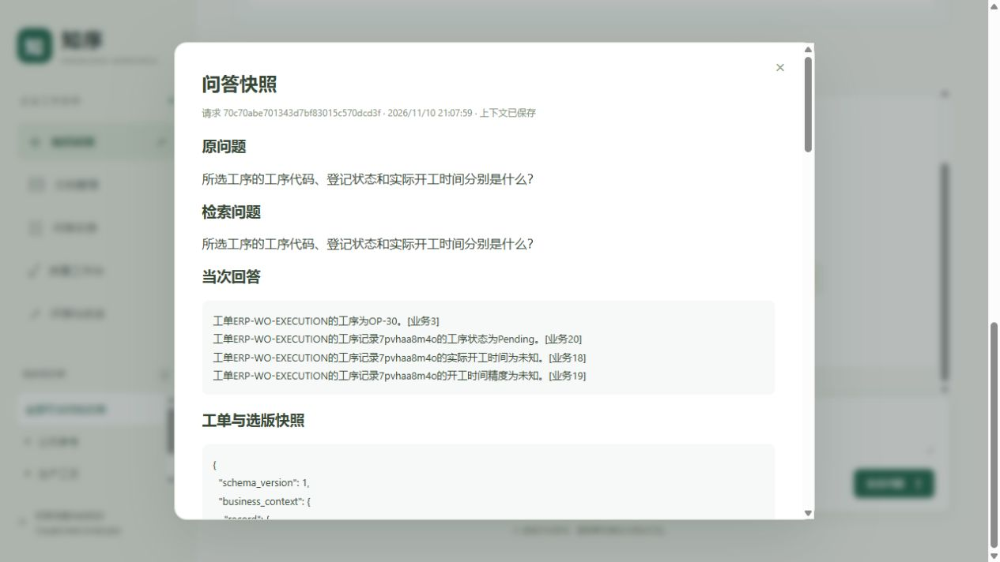
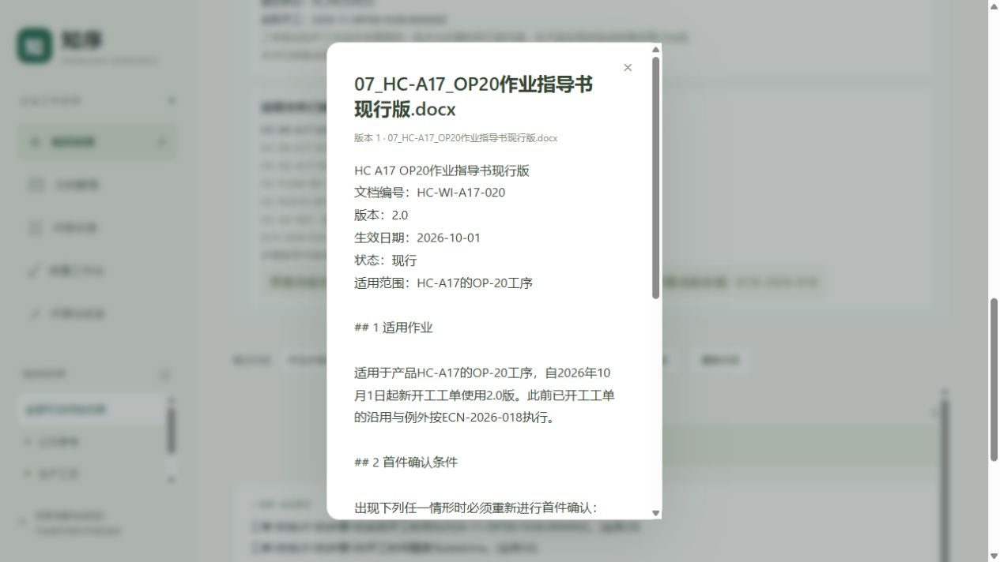

# main 隔离候选部署与零模型验收

2026-11-10，本轮将部署时的 `main / e386bf47a118e8eb50f50ddba258c96a63dc667e` 部署到两个新候选工作台，使用独立数据库副本、Redis 和原件卷。33 项 API 冒烟及选定浏览器流程通过，新增物理模型调用和 Token 均为 0。原 ERPNext/OpenMES 工作台、上游及其他既有容器保留。

这是零模型部署验收，不产生新的模型准确率。上一轮真实模型验证仍为自动 16/16、助手非独立复核 15/16，Q007 的比较覆盖不足和所有旧结果保留，详见[原报告](erpnext-model-v2-20261110-r1.md)。本轮没有重跑该题、正式40题或真实改进闭环。

## 运行入口和隔离范围

| 项目 | ERPNext 候选 | OpenMES 候选 |
| --- | --- | --- |
| 工作台 | <http://127.0.0.1:8005/> | <http://127.0.0.1:8006/> |
| API 容器 | `main-isolated-erpnext-api` | `main-isolated-openmes-api` |
| Redis 容器 | `main-isolated-erpnext-redis` | `main-isolated-openmes-redis` |
| 新数据库 | `main_isolated_erpnext_20261110_r1` | `main_isolated_openmes_20261110_r1` |
| 复制来源 | 上轮保留的 `erpnext_model_v2_20261110_r1` | `openmes_readonly_phase1` |
| 原件卷 | `main-isolated-erpnext-documents` | `main-isolated-openmes-documents` |
| 数据库迁移版本 | `e9b2d4f60713` | `e9b2d4f60713` |

ERP 候选复制上轮隔离验证数据库，因此保留了实际模型回答历史；MES 候选复制原只读工作台数据库，保留审核映射和冻结样本。数据库经 `pg_dump -Fc` / `pg_restore --exit-on-error` 复制；13 份原件分别复制到独立卷，复制后和结束时的文件哈希一致，没有把源原件卷以可写方式挂载到新候选。

隔离的是 API、数据库、Redis 和原件。PostgreSQL 实例、Keycloak、现有向量索引及原 ERPNext/OpenMES 只读适配服务继续复用。没有部署一套新 ERP/MES 上游，也没有升级原适配器。新候选只绑定本机 `127.0.0.1`，不开放公网。

两个新 Keycloak 公共客户端仅允许各自的本机端口和根路径回调，启用 PKCE/S256，禁止密码直授和服务账号。原客户端完整配置摘要不变；候选沿用复制数据库中的现有身份和业务授权，没有提升角色或放宽权限。

## 镜像和零调用约束

共同镜像：`enterprise-knowledge-manufacturing:main-zero-model-20261110-r1`。

- 镜像 ID：`sha256:a2c0b96a5fe2928029e26b5335597cdf67b51c1b76a2f9a365eafaec1ac75d2c`。
- 镜像源代码标签为上述 main 提交；两套实际容器各核对 307 个归档文件，包括 167 个业务 Python 文件，无缺失、变化或额外部署源码文件。
- 基于本机已有依赖镜像，用 `--network=none --pull=false` 构建；未安装新依赖。业务源码、页面和迁移均来自 main 归档。
- 另加部署专用[零预算入口](../../deploy/isolated_demo/zero_runtime.py)，SHA-256 为 `99e868721900e83e6fe5b22857af5b6468680c50557e89f341a83df9e3a16391`，不是 main 内的业务修改。

API 通过 `zero_runtime:app` 启动。每个 HTTP 请求的物理模型调用数和 Token 预算均为 0，使用既有预算机制，在供应商请求前停止；模型任务创建入口拒绝非零预算。候选的生成、重排端点同时改为本机禁用地址，供应商密钥替换为禁用占位值。需要模型生成的新问题会返回 `503 / manufacturing_evaluation_stopped`，属于本环境的预期限制。

没有创建候选索引 Worker 或质量 Worker，没有重建索引，没有新增审核修订或冻结版本。数据库继承的历史模型事件不代表本轮调用，历史问答快照也不代表当前重新生成。

## 验证结果

成功冒烟批次共 33 个请求，覆盖两套健康检查、未登录401、业务权限404且不泄露内容、工单及子对象选择、确定性字段问答、会话保存与恢复、历史真实回答快照、只读执行拒绝、零预算阻断503及非零模型任务拒绝422。ERP 工序 OP-30 的代码、Pending 状态和未知开工均来自所选工序，没有采用父工单状态或开工时间。

浏览器通过真实 Keycloak 登录复验了以下内容，均为助手非独立验收：

- ERP 工序选择、四条业务引用数量、字段原值预览、会话恢复和问答快照；执行请求仅显示一次只读拒绝。
- OpenMES 工单、批次和步骤选择；已开工步骤回答附两条业务引用，来源原值可预览；步骤指导书映射修订7及2.0版指导书原文可打开。
- OpenMES 会话恢复对应批次和步骤；OP-30 未开工步骤保持未知，不用批次时间代填。执行登记不被展示成检验或质量签署完成。
- ERP 320像素快照弹窗和 OpenMES 320像素业务页面的页面宽度均为305，滚动宽度305，无页面级横向溢出；临时窄窗口已关闭，交付页恢复默认窗口。两个核心页面错误日志为空。

本轮9个新增成功问答快照（ERP 5、MES 4，包括确定性拒绝）均核对 `source_verified`、`document_scope_verified`、`business_citations_verified` 为真，`mes_reads=3`。两套候选活动质量任务均为0。

| 零调用证据 | ERP 候选 | MES 候选 |
| --- | --- | --- |
| 候选模型事件总数，前→后 | 424→424 | 393→393 |
| API 观测记录 | 50 | 47 |
| 观测预算调用 / Token / 未知调用 | 0 / 0 / 0 | 0 / 0 / 0 |

事件总数包含复制来的既有账本记录，不等于本轮物理模型调用数。97条观测包含初次失败请求和浏览器操作；另有两条非零任务创建请求在部署入口直接422拒绝、未进入该观测写入分支，其 HTTP 记录另行保留。原 ERP/MES 数据库模型事件 ID 及业务授权摘要也与部署前一致。没有访问实际供应商端点。

## 保留情况与失败记录

原57个容器的 ID、镜像、运行/停止状态、启动时间、重启次数、配置、挂载及网络集合与基线相同。原8003/8004工作台及18080/18081上游健康；170份既有报告、题集配置及两轮私有模型批次文件哈希一致。

以下过程问题保留原记录，没有改写基线或结果：

1. 首次复制 OIDC 客户端保留了 protocol mapper 内部ID，产生409；去掉待创建对象的内部ID后新建成功，没有修改旧客户端。
2. 首次工单列表请求误用 `limit=50`，接口按上限20返回422；改用20后另建 `smoke-r2` 批次完成33项冒烟，原请求保留。
3. 最终签名首次受 Docker 返回挂载列表顺序变化影响；对同一挂载集合逐一排列，重现部署前完整配置哈希。只修正核验方式，未改基线或容器。

自建演示记录不是真实工厂执行证据。此次没有验证新的模型作业指导、视觉解析、真实工厂权限/网络、ERP-MES同步或灾难恢复；不声明全业务或工厂验收通过。

## 本机复现与停止

私有 compose、环境变量、备份、源码归档、原始请求、遥测和浏览器证据保留在 `tmp/main-isolated-demo-20261110-r1/`，被 Git 忽略；其中含本机凭据，不得公开或提交。该目录不是新克隆自动具有的部署配置。登录沿用本机演示账号，不在报告中提供密码或令牌。

在原基础服务就绪、本轮镜像仍在本机时，仅恢复这两个新候选：

```powershell
docker compose -f tmp/main-isolated-demo-20261110-r1/compose.json up -d --pull never
```

若要撤销本轮候选，可执行以下命令；仅停止新 API/Redis 并移除新专用网络，数据库和外部原件卷保留，原 ERPNext/OpenMES 环境不受影响。本轮交付时未执行停止。

```powershell
docker compose -f tmp/main-isolated-demo-20261110-r1/compose.json down
```

不要使用原8003/8004的基础 compose 覆盖新候选，也不要为演示启动模型任务或 Worker。本轮[结构化记录](main-isolated-demo-20261110-r1.json)记录镜像、边界及验证摘要；私有 `final-audit.json`、`snapshot-audit.json`、`smoke-r2/` 和遥测目录保留完整核验证据。

## 页面证据





窄窗口：[ERP 快照](assets/main-isolated-demo-20261110-r1/erpnext-snapshot-narrow.jpg)、[OpenMES 页面](assets/main-isolated-demo-20261110-r1/openmes-narrow.jpg)。
