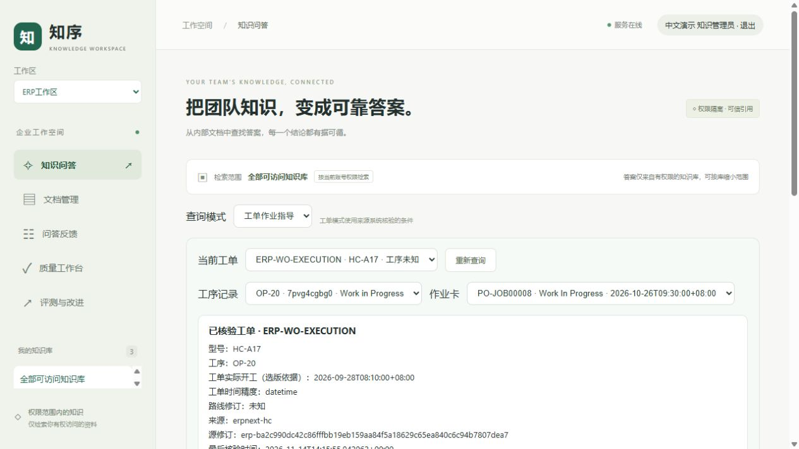
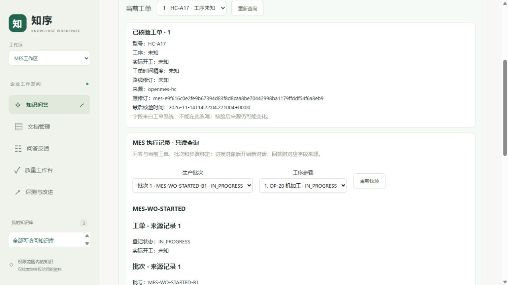

# 8000统一工作台部署与保留核验

2026-11-14按用户要求将通用知识、ERPNext、OpenMES统一到本机8000，并更新为当前分支已冻结源码`a995666e4f446bf1f89b719f6c4c77c27a48b2b5`。三个工作区使用同一镜像，普通文档问答采用已批准的第二版默认提示；原数据库、原件、权限及历史记录保留。8005/8006退出常驻入口。

## 当前入口与版本

| 工作区 | 地址 | 保留的原数据库 |
| --- | --- | --- |
| 通用知识 | http://127.0.0.1:8000/ | enterprise_knowledge |
| ERPNext | http://127.0.0.1:8000/erp/ | main_isolated_erpnext_20261110_r1 |
| OpenMES | http://127.0.0.1:8000/mes/ | main_isolated_openmes_20261110_r1 |

左侧工作区选择器切换地址。三个数据库保持独立，保留各自授权与业务连接；Caddy按路径分发，只有网关发布`127.0.0.1:8000`，三个API不发布主机端口。登录、回调、退出及API请求遵循工作区前缀，PKCE临时状态按工作区隔离。工作区导航是部署开关，独立部署默认关闭。

- 镜像：`enterprise-knowledge-manufacturing:unified-8000-20261114-r1`。
- 镜像ID：`sha256:cd591b4fd73f86f48d375b7a23686e06cd475e1e2fc2a973702cb9dccca3d144`。
- 三个API各168个业务Python文件与冻结源码一致，索引及质量Worker同步使用同一镜像。
- 普通文档默认提示SHA-256：`9c7adf3dc4ee825ef13c659a1b3fae77d64947a6a60f1e52bdb09be68b84621c`，与已采纳r18第二版一致。
- 保持既有Qwen3.7-Flash及模型目的地，ERP/MES使用正常应用入口，支持真实模型调用。
- 本轮仅改入口、前端子路径和部署配置，未调整生成提示、Schema、检索或校验语义。

新建一个精确限定8000三条回调路径的Keycloak公开客户端，使用PKCE S256；旧三个客户端配置保持，数据库授权保持。ERPNext/OpenMES上游与只读适配服务未替换，8003/8004保持停止；8001旧候选未动。

## 数据与历史保留

切换前分别备份三库和容器配置，在无活动索引/评测任务时停止旧API及两个Worker。通用知识库先在独立数据库副本验证迁移，再将原库从`c7e9a1b32458`升级到`e9b2d4f60713`；五次增量迁移保留原行，增加四张业务表。ERP/MES原已处于目标版本。

| 工作区 | 原表数 | 原行指纹保留 | 原件文件保持 | 当前文档行 | 问答记录前→后 | 会话前→后 |
| --- | ---: | ---: | ---: | ---: | ---: | ---: |
| 通用知识 | 27 | 47160 | 184 | 185 | 934→935 | 17→17 |
| ERP | 31 | 3329 | 13 | 13 | 226→229 | 5→6 |
| MES | 31 | 2388 | 13 | 13 | 41→44 | 11→12 |

总计52877个原行指纹、210个原件文件保持，旧行变化0。文档行数与物理文件数分别核对，不将185条通用文档记录说成185份独立有效文件。新增问答、会话与模型账本来自本轮冒烟，未覆盖历史记录。未导入百题评测夹具或新建索引，未删除数据库或卷。迁移验证副本保留。

核对162个原非personal-rag容器：157个元数据保持，预期仅五个旧API/Worker停止并将重启策略设为`no`，无其他容器变化：

- `enterprise-knowledge-api`
- `main-isolated-erpnext-api`
- `main-isolated-openmes-api`
- `enterprise-knowledge-worker`
- `enterprise_knowladge-quality-worker-1`

这些旧容器和原镜像均保留。8005、8006及临时验收端口18890已关闭。

## 验收

| 验证 | 结果与范围 |
| --- | --- |
| 前端回归 | 69项Node测试通过：认证、工作区前缀及会话行为 |
| Python回归 | 15项前端API/会话测试通过 |
| 网关HTTP冒烟 | 33次请求通过，三个工作区就绪、登录权限、知识库列表、原历史读取、ERP/MES字段问答与会话恢复 |
| 业务边界 | ERP/MES快照均保留三次来源核验；参考角色404无业务泄漏，写操作明确只读拒绝；MES映射接口可读 |
| 浏览器 | 正常Keycloak登录及ERP/MES SSO回调正确；工作区切换、ERP工序/卡、MES批次/步骤与分层字段显示通过 |
| 页面检查 | 默认1265像素视口无横向溢出，浏览器控制台错误0；未测试移动端 |
| 真实模型 | 三个工作区各一次文档问答成功，9次物理调用、20956已知及预算Token，未知0、待结算0，独立授权已关闭 |

真实模型冒烟使用实际发布容器和配置，通过TestClient及正常OIDC身份调用现有API，真实数据库和供应商参与；它独立于经网关的HTTP冒烟，不能称全部模型请求均由浏览器发起。每个工作区独立上限15调用/15万预算Token/300秒，未知预留32000；未重试，未复用旧批次。

| 工作区 | 问题范围与人工查看结果 | 调用 | Token | 秒 |
| --- | --- | ---: | ---: | ---: |
| 通用知识 | 已授权归档规范第十四条，数据采集至应用、职责及跨部门机制的回答和引用相符 | 3 | 10718 | 35.972 |
| ERP | HC-A17 OP20首件外径19.95–20.05mm、含端点、量具MIC-025，回答与引用相符 | 3 | 5119 | 21.590 |
| MES | 同一已授权演示指导书的外径、端点及量具问题，回答与引用相符 | 3 | 5119 | 15.389 |

模型与数据库账本一致，每个工作区各新增3个已结算事件。HTTP字段/只读检查没有额外模型调用。以上为助手非独立部署功能检查；不重算百题、不产生生产准确率，也不替代工厂验收。最近完整r18的结构96/100、助手非独立语义85/100继续作为[原隔离验证成绩](manufacturing-prompt-v2-full-live-20261114-r18.md)保留，本轮未覆盖旧结果。





## 启动与回退

本机凭据、实际Compose、备份、日志及完整核验凭证保存在忽略目录`tmp/unified-workspace-8000-20261114-r1/`，不提交。基础数据库、Redis、向量、Keycloak及上游服务沿用现状。本机应用启动使用：

```powershell
docker compose -f tmp/unified-workspace-8000-20261114-r1/compose.json --profile workers up -d --pull never
```

不要用旧根Compose或旧8005/8006启动配置替代该入口，否则会重启旧应用或重新发布旧端口。通用索引及质量Worker已升级并运行，未为本次验收自动创建评测任务。

需要应用回退时，已准备以下显式执行脚本（本轮未执行回退）：

```powershell
.venv/Scripts/python.exe tmp/unified-workspace-8000-20261114-r1/rollback.py --execute
```

该脚本停止新应用、恢复旧五个容器的原重启策略和入口；保留全部SQL与新增数据，不自动降级数据库或回灌备份。数据库恢复须另行比较切换后新增记录，避免丢失历史。旧版本镜像和切换前备份均保留。

## 准备阶段记录

准备时修正了只读盘点表名、Compose健康检查字段；18090被其他程序占用，未触碰该程序，改用临时18890。仅内部网络的网关无法发布主机端口，增加网关边缘网络后通过验收，API继续不对主机发布。

HTTP脚本首次对知识库会话用了全局路径，404后依据实际路径改正；原失败记录保留。模型预检首次选中的通用文档不在账号授权内，调用前停止且模型0；保持权限，改选已授权归档规范，再独立完成三个一次性问题。以上不属于生成失败重试或百题补跑，无业务规则修补。

公开脱敏计数见[部署摘要JSON](unified-workspace-8000-20261114-r1.json)。私有配置、凭据、完整容器检查和令牌未进入公开报告；截图仅包含自建演示数据。
